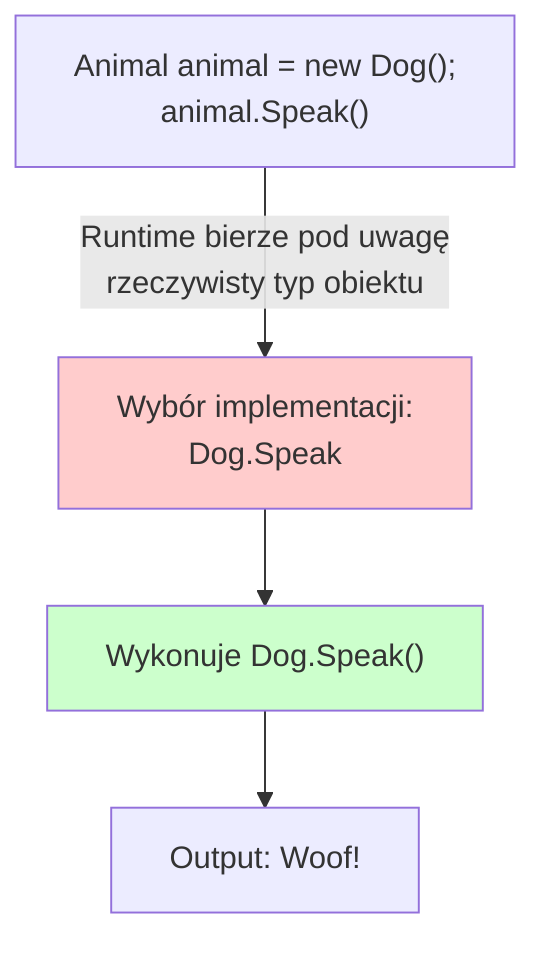

# Temat 1: Funkcje Wirtualne - Wstęp

## 📌 Cel Tematu

Zrozumienie **funkcji wirtualnych** (`virtual`) jako fundamentu **polimorfizmu** w C# - mechanizmu pozwalającego na dynamiczne wiązanie (late binding) metod w runtime.

## 🎯 Kluczowe Koncepty

### 1. Co to jest funkcja wirtualna?

Funkcja wirtualna to metoda w klasie bazowej, którą możemy **przesłonić** (override) w klasach pochodnych. Jej wykonanie jest określane **w runtime** na podstawie rzeczywistego typu obiektu, a nie typu zmiennej.

```csharp
public class Animal
{
    public virtual void Speak()  // Słowo virtual oznacza: mogę być przesłonięta
    {
        Console.WriteLine("Generic animal sound");
    }
}

public class Dog : Animal
{
    public override void Speak()  // override - przesłaniamy metodę
    {
        Console.WriteLine("Woof! Woof!");
    }
}
```

### 2. Polimorfizm a Funkcje Wirtualne

**Polimorfizm** (z grec. "wiele form") oznacza, że ten sam kod może działać na różne sposoby:

```csharp
Animal animal = new Dog();        // Zmienna typu Animal
animal.Speak();                    // Ale wołamy Dog.Speak()!
                                   // Compiler: pytaj Animala
                                   // Runtime: wykonaj Dog'a
```

To jest **wczesne wiązanie vs. późne wiązanie**:

| Aspekt | Bez Virtual | Z Virtual |
|--------|-------------|-----------|
| **Kiedy decyzja** | Compile-time | Runtime |
| **Typ zmiennej** | Decyduje typ zmiennej | Ignoruje się |
| **Typ obiektu** | Ignoruje się | Decyduje rzeczywisty typ |
| **Słowo kluczowe** | (brak) | `virtual` w bazie, `override` w pochodnej |

### 3. Dlaczego wirtualne metody są ważne?

Pozwalają nam pisać kod, który pracuje z **abstrakcyjnym typem** (Animal), ale wykonuje **konkretne działania** (Dog, Cat, Bird):

```csharp
List<Animal> animals = new()
{
    new Dog(),
    new Cat(),
    new Bird()
};

foreach (var animal in animals)
{
    animal.Speak();  // Każdy robi to, co powinien!
}
// Output:
// Woof! Woof!
// Meow! Meow!
// Tweet! Tweet!
```

---

## 📚 Teoria: Wczesne vs. Późne Wiązanie

### Wczesne Wiązanie (Early Binding) - BEZ Virtual

```csharp
public class Vehicle
{
    public void Start()  // Brak 'virtual'
    {
        Console.WriteLine("Vehicle starting...");
    }
}

public class Car : Vehicle
{
    public new void Start()  // 'new' - świadome ukrycie (bez niego: ostrzeżenie CS0108)
    {
        Console.WriteLine("Car starting...");
    }
}

Vehicle vehicle = new Car();
vehicle.Start();  // Wywoła: Vehicle.Start() - decyzja na compile-time!
```

**Wczesne wiązanie** = kompilator patrzy na typ zmiennej (`Vehicle`) i wiąże wywołanie z metodą `Vehicle.Start`. Metoda `Car.Start` tylko *ukrywa* bazową - szczegóły w [temacie 3](../_03_virtual_vs_new/README.md).

### Późne Wiązanie (Late Binding) - Z Virtual

```csharp
public class Vehicle
{
    public virtual void Start()  // 'virtual' - mogę być przesłonięta
    {
        Console.WriteLine("Vehicle starting...");
    }
}

public class Car : Vehicle
{
    public override void Start()  // 'override' - przesłaniam wirtualną
    {
        Console.WriteLine("Car starting...");
    }
}

Vehicle vehicle = new Car();
vehicle.Start();  // Wywoła: Car.Start() - decyzja w runtime!
```

**Późne wiązanie** = wywołanie metody wirtualnej jest rozstrzygane na podstawie rzeczywistego typu obiektu (`Car`). Nie oznacza to, że wszystkie wywołania metod w C# są dynamiczne: zwykłe metody, przeciążenia i `static` są wiązane według innych reguł.

---

## 🔍 Dlaczego to Działa? - Virtual Method Table (VMT)

Dla klas z metodami wirtualnymi CLR przechowuje informacje potrzebne do wyboru implementacji w czasie działania. Często opisuje się to uproszczonym modelem **VMT** (virtual method table), ale jest to szczegół implementacyjny runtime, a nie publiczny kontrakt C#. Tablica obejmuje tylko metody **wirtualne** - zwykłe metody (`Eat`) są wiązane już przez kompilator:

```
Animal:
  └─ Speak() → Animal.Speak           (virtual)

Dog : Animal
  └─ Speak() → Dog.Speak              [OVERRIDE]

Cat : Animal
  └─ Speak() → Cat.Speak              [OVERRIDE]

Bird : Animal   (bez własnego override)
  └─ Speak() → Animal.Speak           [DZIEDZICZONE]

Eat() jest niewirtualna - wywołanie animal.Eat() zawsze trafia do Animal.Eat
```

---

## 💡 Praktyczne Zastosowania

### 1. Framework'i i Biblioteki

```csharp
// Framework definiuje klasę bazową
public abstract class HttpResponse
{
    public virtual void SendHeader()
    {
        Console.WriteLine("HTTP/1.1 200 OK");
    }
}

// Deweloper tworzy swoją implementację
public class JsonResponse : HttpResponse
{
    public override void SendHeader()
    {
        Console.WriteLine("HTTP/1.1 200 OK");
        Console.WriteLine("Content-Type: application/json");
    }
}
```

### 2. Systemy Pluginów

```csharp
public class PluginManager
{
    private List<Plugin> plugins = new();
    
    public void ExecuteAll()
    {
        foreach (var plugin in plugins)
        {
            plugin.Execute();  // Każdy plugin robi coś innego!
        }
    }
}

public abstract class Plugin
{
    public abstract void Execute();  // Każdy plugin musi to implementować
}
```

### 3. Kolekcje Różnych Typów

```csharp
List<PaymentMethod> methods = new()
{
    new CreditCard(50m),
    new PayPal(75m),
    new Bitcoin(100m)
};

foreach (var method in methods)
{
    method.ProcessPayment();  // Każdy płaci po swojemu!
}
```

---

## 🎓 Reguły Virtual Methods

### ✅ Wymagania dla Virtual

1. **Klasa bazowa**: metoda musi mieć `virtual` (albo `abstract` lub być sama `override`)
2. **Klasa pochodna**: metoda musi mieć `override`
3. **Sygnatura**: ta sama nazwa i parametry; modyfikator dostępu musi być identyczny; typ zwracany taki sam lub (od C# 9) kowariantny
4. Metody `static` i `private` nie mogą być wirtualne

```csharp
public class Base
{
    public virtual void Method()  // ✅ Wirtualna
    {
    }
    
    public virtual int Calculate(int x)  // ✅ Wirtualna z parametrem
    {
        return x * 2;
    }
}

public class Derived : Base
{
    public override void Method()  // ✅ Override identycznej sygnatury
    {
    }
    
    public override int Calculate(int x)  // ✅ Override identycznej sygnatury
    {
        return x * 3;
    }
}
```

### ❌ Błędy

```csharp
// Błąd 1: brak 'virtual' w klasie bazowej
public class Base
{
    public void Method() { }  // ❌ Nie virtual!
}

public class Derived : Base
{
    public override void Method() { }  // ❌ BŁĄD: nie ma co przesłaniać!
}

// Błąd 2: inna sygnatura
public class Base
{
    public virtual void Method(int x) { }  // ✅ Virtual
}

public class Derived : Base
{
    public override void Method() { }  // ❌ BŁĄD: inna sygnatura!
}
```

---

## 📊 Diagram: Virtual Methods Flow



---

## 🔗 Referencje

- [Microsoft Learn: Polymorphism](https://learn.microsoft.com/en-us/dotnet/csharp/fundamentals/object-oriented/polymorphism)
- [Microsoft Learn: virtual](https://learn.microsoft.com/en-us/dotnet/csharp/language-reference/keywords/virtual)
- [Microsoft Learn: override](https://learn.microsoft.com/en-us/dotnet/csharp/language-reference/keywords/override)
- Porównanie z Javą: [Temat 3](../_03_virtual_vs_new/README.md#-porównanie-z-polimorfizmem-w-javie)

---

## ✨ Podsumowanie

| Koncept | Znaczenie |
|---------|-----------|
| **virtual** | Metoda może być przesłonięta |
| **override** | Przesłaniam metodę wirtualną |
| **Late Binding** | Decyzja o metodzie w runtime |
| **Polimorfizm** | Ten sam kod, różne wykonania |
| **VMT** | Uproszczony model wyboru metody wirtualnej (szczegół CLR) |

---

## 📁 Kod Demonstracyjny

Znajduje się w katalogu `code/`:
- `Program.cs` - Demonstracja i testy xUnit

Uruchomienie:
```bash
cd code
dotnet run
dotnet test
```

---

## 🧭 Nawigacja

| Przejdź do | Link |
|---|---|
| Poprzedni moduł | [05-dziedziczenie](../../05-dziedziczenie/README.md) |
| Moduł | [06-polimorfizm](../README.md) |
| Następny temat | [Temat 2: Przykład funkcji wirtualnych](../_02_virtual_methods_example/README.md) |

Przejdź dalej, aby zobaczyć, jak wspólny kod procesora może obsługiwać wiele metod płatności.
