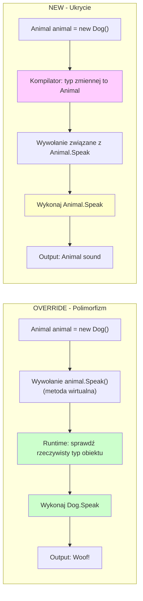

# Temat 3: Virtual vs New - Kombinacja Słów Kluczowych

## 📌 Cel Tematu

Zrozumienie **różnicy między `override` i `new`** - dwa sposoby deklarowania metody o tej samej sygnaturze w klasie pochodnej, które prowadzą do **zupełnie różnego zachowania**. Na końcu tematu znajdziesz [porównanie z polimorfizmem w Javie](#-porównanie-z-polimorfizmem-w-javie).

## ⚠️ Problem: Co Się Dzieje Tutaj?

```csharp
public class Animal
{
    public virtual void Speak() => Console.WriteLine("Animal sound");
}

public class Dog : Animal
{
    public new void Speak() => Console.WriteLine("Woof!");  // ⚠️ new (ukrycie) zamiast override
}

Animal animal = new Dog();
animal.Speak();  // Co się wypisze??
```

Odpowiedź: `"Animal sound"` - a nie `"Woof!"`! Dlaczego?

---

## 🔍 Głębokie Wyjaśnienie

### Override vs New

| Aspect | Override | New |
|--------|----------|-----|
| **Słowo kluczowe** | `public override` | `public new` |
| **Wymaga virtual** | TAK | NIE |
| **Late binding** | TAK | NIE |
| **Polimorfizm** | TAK | NIE |
| **Typ zmiennej** | Ignoruje | Decyduje |
| **Typ obiektu** | Decyduje | Ignoruje |

### Przykład: Override (Polimorfizm)

```csharp
public class Animal
{
    public virtual void Speak()
    {
        Console.WriteLine("Generic sound");
    }
}

public class Dog : Animal
{
    public override void Speak()  // ✅ OVERRIDE - będzie użyta w runtime!
    {
        Console.WriteLine("Woof!");
    }
}

Animal animal = new Dog();
animal.Speak();  // Output: "Woof!" (Dog's version)
```

**Override** = wywołanie metody wirtualnej jest rozstrzygane w czasie działania programu według rzeczywistego typu obiektu (`Dog`).

### Przykład: New (Ukrycie)

```csharp
public class Animal
{
    public void Speak()  // Bez 'virtual'
    {
        Console.WriteLine("Generic sound");
    }
}

public class Dog : Animal
{
    public new void Speak()  // ⚠️  NEW - ukrycie, nie override!
    {
        Console.WriteLine("Woof!");
    }
}

Animal animal = new Dog();
animal.Speak();  // Output: "Generic sound" (Animal's version)
```

**New** = kompilator wybiera metodę na podstawie **typu zmiennej** (`Animal`), więc rzeczywisty typ obiektu nie ma wpływu na wynik. `new` działa tak samo, gdy metoda bazowa jest `virtual` (pierwszy przykład w tym temacie) i gdy jest zwykła.

---

## 📊 Diagram: Override vs New



---

## 🎯 Reguły

### ✅ Override (Prawidłowe)

```csharp
public class Base
{
    public virtual void Method() { }  // ✅ Virtual
}

public class Derived : Base
{
    public override void Method() { }  // ✅ Override
}
```

### ⚠️  New (Może Być Ryzykowne)

```csharp
public class Base
{
    public virtual void Method() { }  // Virtual
}

public class Derived : Base
{
    public new void Method() { }  // ⚠️  Ukrycie - kod używający Base nie zobaczy tej wersji
}

Base b = new Derived();
b.Method();  // Wywoła Base.Method, nie Derived.Method!
```

Taki kod kompiluje się i działa bez błędu, ale `Derived` nie może być bezpiecznie używana tam, gdzie oczekiwany jest `Base`, jeśli autor liczył na własną wersję metody. Bez słowa `new` kompilator zgłosi tylko ostrzeżenie `CS0114` (dla ukrywanej metody wirtualnej; dla niewirtualnej - `CS0108`), a zachowanie będzie identyczne: ukrycie.

---

## 🚨 Problemy z New

### Problem 1: Łamanie Oczekiwań

```csharp
public abstract class PaymentMethod
{
    public virtual void ProcessPayment()
    {
        Console.WriteLine("Processing...");
    }
}

public class SpecialPayment : PaymentMethod
{
    public new void ProcessPayment()  // ⚠️  OOPS!
    {
        Console.WriteLine("Special processing...");
    }
}

List<PaymentMethod> payments = new() { new SpecialPayment() };
foreach (var p in payments)
{
    p.ProcessPayment();  // Wołuje Base, nie Special!
    // Bug! Kod był w SpecialPayment!
}
```

### Problem 2: Debugging Nightmare

```csharp
// Ktoś widzi:
payment.ProcessPayment();

// I myśli "to wołuje SpecialPayment.ProcessPayment()"
// ALE to wołuje Base.ProcessPayment()!
// Dlaczego? Bo `new` zamiast `override`
```

---

## 💡 Kiedy Używać Co?

### Użyj `override` gdy:
- [ ] Metoda w bazowej jest `virtual`
- [ ] Chcesz **zmienić zachowanie** w pochodnej
- [ ] Chcesz **polimorfizmu** (late binding)
- [ ] Chcesz szanować kontrakt klasy bazowej

### Użyj `new` gdy:
- [ ] Ukrywasz członka, którego **nie możesz** uczynić wirtualnym (np. z biblioteki, której nie kontrolujesz)
- [ ] Naprawdę chcesz, aby wersja zależała od **typu zmiennej**, i jest to udokumentowane w API
- [ ] Rozwiązujesz konflikt nazw, np. po dodaniu członka do klasy bazowej w nowej wersji biblioteki

`new` jest rzadkie. Jeśli metoda w bazie jest `virtual`, prawie zawsze właściwy jest `override`. Przy różnej **sygnaturze** (np. innych parametrach) nie ma żadnego ukrycia - powstaje po prostu przeciążenie i `new` nie jest potrzebne.

---

## 🔗 Liskov Substitution Principle (LSP)

**GOLDEN RULE**: obiekt klasy pochodnej powinien dać się użyć wszędzie tam, gdzie oczekiwany jest typ bazowy, bez łamania jego kontraktu (zasada podstawiania Liskov).

Naruszenie LSP **nie wymaga** słowa `new`. Najczęściej powstaje przez `override`, który odrzuca to, co klasa bazowa obiecuje:

```csharp
public abstract class Bird
{
    public virtual void Fly() => Console.WriteLine("Flying");
}

public class Eagle : Bird
{
    public override void Fly() => Console.WriteLine("Flying high!");  // ✅ zgodne z kontraktem
}

// ❌ Naruszenie LSP przez override: kontrakt Bird mówi "ptak lata"
public class Penguin : Bird
{
    public override void Fly() => throw new NotSupportedException("Penguins can't fly");
}

Bird bird = new Penguin();
bird.Fly();  // 💥 NotSupportedException - kod pracujący z Bird jest zepsuty
```

Rozwiązanie to **poprawić model**, a nie ukryć problem: `Bird` nie powinien obiecywać `Fly()`; latanie można wyodrębnić np. do `FlyingBird` albo interfejsu `IFlyer`.

`new` tworzy inny, mniej oczywisty problem - niespójność zależną od typu zmiennej:

```csharp
public class Penguin : Bird
{
    public new void Fly() => throw new NotSupportedException();  // tylko przez zmienną typu Penguin
}

Penguin penguin = new Penguin();
Bird bird = penguin;

bird.Fly();     // wypisze "Flying" - wersja Bird, bez wyjątku
penguin.Fly();  // 💥 NotSupportedException
```

Ten sam obiekt zachowuje się inaczej zależnie od tego, przez jaką zmienną go wywołano.

---

## 📊 Real-World Przykłady

### Baza danych: Repository Pattern

```csharp
public abstract class Repository<T>
{
    public virtual void Save(T item)
    {
        Console.WriteLine("Saving to database...");
    }
}

// ✅ DOBRY - CacheRepository
public class CacheRepository<T> : Repository<T>
{
    public override void Save(T item)  // ✅ Override
    {
        Console.WriteLine("Saving to cache first...");
        base.Save(item);  // Call base
        Console.WriteLine("Also saving to database...");
    }
}

// ❌ ZŁY - DatabaseSpecificRepository  
public class DatabaseSpecificRepository<T> : Repository<T>
{
    public new void Save(T item)  // ❌ New - będzie bug!
    {
        Console.WriteLine("Custom save logic...");
    }
}
```

---

## 🎓 Reguły Kciuka

1. **Zawsze używaj `override`**, jeśli chcesz zmienić zachowanie metody `virtual`
2. **`new` nie jest błędem samym w sobie** - jawnie ukrywa członka bazowego i czasem jest świadomą decyzją API.
3. Jeśli używasz `new`, udokumentuj powód i sprawdź zachowanie przez referencję bazową.
4. Metoda przesłaniająca powinna **zachować kontrakt** metody bazowej (te same obietnice co do wyniku i skutków ubocznych), nawet jeśli zmienia sposób działania.

---

## ☕ Porównanie z polimorfizmem w Javie

Mechanizm jest ten sam - **dynamiczne wiązanie metod instancyjnych według rzeczywistego typu obiektu** - ale język inaczej go wyraża.

| Aspekt | C# | Java |
|--------|----|------|
| Metody instancyjne domyślnie | **niewirtualne** (trzeba `virtual`) | **wirtualne** (nie ma słowa `virtual`) |
| Przesłonięcie | `override` (słowo kluczowe, obowiązkowe) | adnotacja `@Override` (opcjonalna, ale zalecana) |
| Ta sama sygnatura w klasie pochodnej bez dodatkowych słów | **ukrywa** metodę bazową (ostrzeżenie `CS0114`/`CS0108`) | **przesłania** metodę bazową |
| Jawne ukrycie metody instancyjnej | `new` | brak odpowiednika |
| Zablokowanie dalszego przesłaniania | `sealed override` | `final` na metodzie |
| Zablokowanie dziedziczenia klasy | `sealed class` | `final class` |
| Metody statyczne | nie są polimorficzne | nie są polimorficzne (są *ukrywane*) |
| Pola | nie są polimorficzne | nie są polimorficzne (są *ukrywane*) |
| Modyfikator dostępu przy przesłonięciu | musi być identyczny | może być **szerszy**, nie węższy |
| Typ zwracany przy przesłonięciu | ten sam lub kowariantny (C# 9+) | ten sam lub kowariantny (od Javy 5) |
| Metoda abstrakcyjna | `abstract` + `override` w pochodnej | `abstract` + implementacja (`@Override`) |
| Domyślne metody w interfejsie | od C# 8 (bez osobnego słowa kluczowego) | od Javy 8 (`default`) |

### Ten sam kod w obu językach

```java
// Java - Animal.speak() jest wirtualna automatycznie
class Animal {
    void speak() { System.out.println("Animal sound"); }
}

class Dog extends Animal {
    @Override
    void speak() { System.out.println("Woof!"); }   // przesłania
}

Animal animal = new Dog();
animal.speak();   // "Woof!"
```

```csharp
// C# - trzeba jawnie włączyć polimorfizm
class Animal
{
    public virtual void Speak() => Console.WriteLine("Animal sound");
}

class Dog : Animal
{
    public override void Speak() => Console.WriteLine("Woof!");   // przesłania
}

Animal animal = new Dog();
animal.Speak();   // "Woof!"
```

### Największa pułapka dla programisty Javy

```java
// Java: brak @Override nadal oznacza przesłonięcie
class Dog extends Animal {
    void speak() { System.out.println("Woof!"); }
}
Animal a = new Dog();
a.speak();   // "Woof!"
```

```csharp
// C#: brak override (i new) to UKRYCIE, nie przesłonięcie
class Dog : Animal
{
    public void Speak() => Console.WriteLine("Woof!");   // warning CS0114
}
Animal a = new Dog();
a.Speak();   // "Animal sound" !
```

W Javie literówka w nazwie lub parametrze tworzy po prostu *nową* metodę - dlatego `@Override` pozwala kompilatorowi to wykryć. W C# `override` jest **wymagany** do przesłonięcia, a ostrzeżenie `CS0114` (`CS0108` dla metod niewirtualnych) zwraca uwagę na przypadkowe ukrycie.

### Różnice wartościowe do zapamiętania

- **Ukrywanie w Javie** dotyczy metod `static` i pól. Zachowuje się podobnie do `new` w C#: wynik zależy od **typu zmiennej**, a nie obiektu.
- **Metody prywatne** nie są przesłaniane w żadnym z tych języków.
- **Wywołanie metody przesłanianej w konstruktorze** jest ryzykowne w obu językach: w Javie pola pochodnej mają jeszcze wartości domyślne, a w C# działają już inicjalizatory pól klasy pochodnej, ale **nie** kod jej konstruktora (zob. [moduł 05, temat 3](../../05-dziedziczenie/_03_derived_constructors/README.md)).
- **`sealed` w Javie 17+** (`sealed ... permits`) oznacza co innego niż `sealed` w C#: ogranicza *które* klasy mogą dziedziczyć, a nie zakazuje dziedziczenia w ogóle. Odpowiednikiem C# `sealed class` jest Java `final class`.
- **Wydajność:** w obu platformach JIT optymalizuje wywołania wirtualne (np. devirtualizacja), więc różnica kosztu rzadko powinna wpływać na projekt.

---

## 📁 Kod Demonstracyjny

Znajduje się w katalogu `code/`:
- `Program.cs` - Porównanie override vs new

---

## 🔗 Referencje

- [Liskov Substitution Principle](https://en.wikipedia.org/wiki/Liskov_substitution_principle)
- [Microsoft Learn: Knowing when to use override and new keywords](https://learn.microsoft.com/en-us/dotnet/csharp/programming-guide/classes-and-structs/knowing-when-to-use-override-and-new-keywords)
- [Oracle Java Tutorial: Overriding and Hiding Methods](https://docs.oracle.com/javase/tutorial/java/IandI/override.html)

Uruchomienie:
```bash
cd code
dotnet run
```

## 🧭 Nawigacja

| Przejdź do | Link |
|---|---|
| Poprzedni temat | [Temat 2: Funkcje wirtualne w praktyce](../_02_virtual_methods_example/README.md) |
| Moduł | [06-polimorfizm](../README.md) |
| Następny temat | [Temat 4: Metody klasy Object](../_04_object_methods/README.md) |
