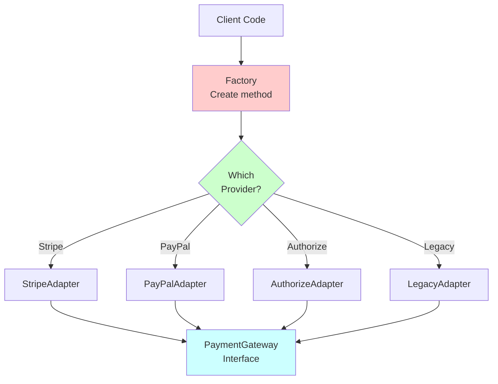

# Temat 5: Wzorzec Adapter Połączony z Fabryką

## 📌 Cel Tematu

Połączenie dwóch wzorców projektowych:
- **Adapter** - konwersja interfejsu na inny
- **Factory** - centralne tworzenie obiektów

Praktyczne zastosowanie: integracja systemów payment z różnymi gatewayami.

## 🎯 Problem: Różne Interfejsy

Wyobraź sobie e-commerce z wieloma payment gateway'ami:
- Stripe API
- PayPal API
- Authorize.net API
- Własny system Legacy

**Problem**: Każdy ma inny interfejs!

```csharp
// Stripe
stripe.Charge(amount, token);

// PayPal
paypal.Execute(transaction);

// Legacy
legacyPay.ProcessTransaction(id, amount, method);
```

**Rozwiązanie**: Adapter + Factory

---

## 🏗️ Adapter Pattern

### Klasa Bazowa (Target)

```csharp
public abstract class PaymentGateway
{
    public abstract void Authorize(decimal amount);
    public abstract void Capture();
    public abstract void Refund();
}
```

W literaturze "Target" to zwykle interfejs; tutaj pełni go klasa abstrakcyjna, dzięki czemu polimorfizm działa przez wywołania metod wirtualnych/abstrakcyjnych (temat 1). Adaptery mogłyby równie dobrze implementować interfejs `IPaymentGateway`.

### Adaptory (Adapters)

```csharp
// Adapt Stripe to our interface
public class StripeAdapter : PaymentGateway
{
    private readonly IStripeClient _stripeClient;
    
    public override void Authorize(decimal amount)
    {
        _stripeClient.Charge(amount, token);  // Stripe's method
    }
}

// Adapt PayPal to our interface
public class PayPalAdapter : PaymentGateway
{
    private readonly IPayPalClient _paypalClient;
    
    public override void Authorize(decimal amount)
    {
        _paypalClient.Execute(new Transaction { Amount = amount });  // PayPal's method
    }
}
```

> **Uproszczenie:** to szkic (pominięto m.in. konstruktor i definicję `token`). W kodzie demonstracyjnym operacja `Authorize` jest mapowana na pojedyncze wywołanie zewnętrznego klienta. Prawdziwe bramki płatnicze zwykle rozróżniają autoryzację i przechwycenie środków (capture) i wymagają osobnych wywołań.

---

## 🏭 Factory Pattern

### Simple Factory

```csharp
public class PaymentGatewayFactory
{
    public static PaymentGateway Create(string providerName)
    {
        return providerName switch
        {
            "Stripe" => new StripeAdapter(),
            "PayPal" => new PayPalAdapter(),
            "Authorize" => new AuthorizeNetAdapter(),   // przykład rozszerzenia - nie ma go w kodzie demonstracyjnym
            "Legacy" => new LegacyAdapter(),
            _ => throw new ArgumentException($"Unknown provider: {providerName}")
        };
    }
}

// Użycie
var gateway = PaymentGatewayFactory.Create("Stripe");
gateway.Authorize(100m);
```

---

## 📊 Diagram: Adapter + Factory



---

## 💳 Real-World: Payment Processing

### Przed (Bez Adapteru)

```csharp
public void ProcessPayment(string provider, decimal amount)
{
    switch (provider)
    {
        case "Stripe":
            var stripe = new StripeClient();
            stripe.Charge(amount, token);  // Stripe's API
            break;
        
        case "PayPal":
            var paypal = new PayPalClient();
            paypal.Execute(new Transaction { Amount = amount });  // PayPal's API
            break;
        
        case "Legacy":
            var legacy = new LegacyPaymentSystem();
            legacy.ProcessTransaction(id, amount, method);  // Legacy API
            break;
    }
}

// Problem: Duża switch, różne API'e w jednym miejscu
```

### Po (Z Adapterem + Fabryką)

```csharp
public void ProcessPayment(string provider, decimal amount)
{
    var gateway = PaymentGatewayFactory.Create(provider);
    gateway.Authorize(amount);      // ✅ Unified interface
    gateway.Capture();
    gateway.Refund();
}

// Elegancko! Jeden interfejs dla wszystkich
```

---

## 🔌 Integracja: Fake vs Real

### Dla Testów

```csharp
public class FakePaymentGateway : PaymentGateway
{
    public override void Authorize(decimal amount)
    {
        Console.WriteLine($"[FAKE] Authorized ${amount}");
    }
    
    public override void Capture()
    {
        Console.WriteLine("[FAKE] Captured");
    }

    public override void Refund()
    {
        Console.WriteLine("[FAKE] Refunded");
    }
}
```

W kodzie demonstracyjnym fabryka potrafi utworzyć `FakeGateway` (`"fake"`/`"test"`), co jest wygodne w nauce. W prawdziwej aplikacji **nie umieszczaj ścieżek testowych w fabryce produkcyjnej** - lepiej w testach przekazać atrapę przez wstrzykiwanie zależności albo osobną konfigurację środowiska.

---

## 💾 Dependency Injection Integration

W kodzie demonstracyjnym `PaymentGatewayFactory` ma **statyczną** metodę `Create`, więc nie da się jej wstrzyknąć ani podmienić w testach. Wersja przyjazna DI wymaga interfejsu i klasy niestatycznej:

```csharp
public interface IPaymentGatewayFactory
{
    PaymentGateway Create(string providerName);
}

public class OrderService
{
    private readonly IPaymentGatewayFactory _factory;
    
    public OrderService(IPaymentGatewayFactory factory)
    {
        _factory = factory;  // Injected!
    }
    
    public void ProcessOrder(Order order)
    {
        var gateway = _factory.Create(order.PaymentProvider);
        gateway.Authorize(order.Total);
        gateway.Capture();
    }
}

// Rejestracja w DI (fabryka jest bezstanowa, więc wystarczy jedna instancja):
services.AddSingleton<IPaymentGatewayFactory, PaymentGatewayFactory>();
services.AddScoped<OrderService>();
```

---

## 🎯 Złożony Adapter: Multi-Provider Fallback

```csharp
public class FallbackAdapter : PaymentGateway
{
    private readonly List<PaymentGateway> _gateways;
    
    public FallbackAdapter(params PaymentGateway[] gateways)
    {
        _gateways = gateways.ToList();
    }
    
    public override void Authorize(decimal amount)
    {
        foreach (var gateway in _gateways)
        {
            try
            {
                gateway.Authorize(amount);
                return;  // Success!
            }
            catch (InvalidOperationException)
            {
                // Try next gateway
            }
        }
        
        throw new InvalidOperationException("All payment gateways failed");
    }
}

// Użycie
var fallback = new FallbackAdapter(
    new StripeAdapter(),
    new PayPalAdapter(),
    new LegacyAdapter()
);

fallback.Authorize(100m);  // Spróbuj Stripe, potem PayPal, potem Legacy
```

> ⚠️ **Uwaga przy płatnościach:** automatyczne przechodzenie do kolejnego dostawcy po błędzie może **obciążyć klienta dwa razy**, jeśli pierwszy dostawca zdążył przetworzyć żądanie, ale odpowiedź zaginęła (timeout). W realnych systemach stosuje się klucze idempotencji i sprawdzanie stanu transakcji przed ponowieniem; przechwytuj też wyłącznie wyjątki oznaczające "dostawca niedostępny" (najlepiej własny typ wyjątku), a nie ogólne błędy. Przykład ma charakter dydaktyczny - pokazuje kompozycję adapterów, nie gotowy mechanizm produkcyjny.

---

## 🏪 E-Commerce Integration

```csharp
public class PaymentProcessor
{
    private readonly IPaymentGatewayFactory _factory;
    
    public PaymentProcessor(IPaymentGatewayFactory factory)
    {
        _factory = factory;
    }
    
    public PaymentResult ProcessOrder(Order order)
    {
        var gateway = _factory.Create(order.PaymentProvider);
        
        gateway.Authorize(order.Total);
        gateway.Capture();
        
        return new PaymentResult
        {
            TransactionId = gateway.TransactionId,
            Status = PaymentStatus.Completed
        };
    }
}
```

`PaymentResult` i `PaymentStatus` są tu typami ilustracyjnymi - kod demonstracyjny w tym temacie zwraca po prostu `bool` z `OrderProcessor.ProcessOrder`.

---

## 📁 Kod Demonstracyjny

Znajduje się w katalogu `code/`:
- `Program.cs` - Pełna implementacja Adapter + Factory

Uruchomienie:
```bash
cd code
dotnet run
```

---

## 🔗 Referencje

- [Adapter Pattern](https://refactoring.guru/design-patterns/adapter)
- [Factory Pattern](https://refactoring.guru/design-patterns/factory-method)
- [Dependency injection in .NET](https://learn.microsoft.com/en-us/dotnet/core/extensions/dependency-injection)

## 🧭 Nawigacja

| Przejdź do | Link |
|---|---|
| Poprzedni temat | [Temat 4: Metody klasy Object](../_04_object_methods/README.md) |
| Moduł | [06-polimorfizm](../README.md) |
| Następny temat | [Temat 6: Default Interface Members](../_06_default_interface_members/README.md) |
