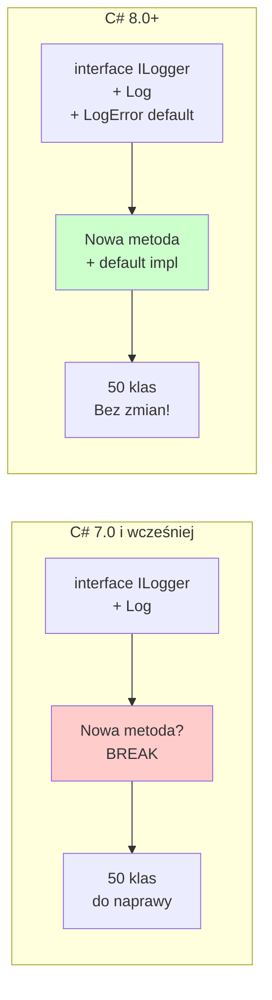

# Temat 6: Default Interface Members - Nowoczesne C# (8+)

## 📌 Cel Tematu

Zrozumienie **Default Interface Members** - funkcjonalności dostępnej od C# 8.0, która pozwala na **implementację kodu w interfejsach**.

## 🚀 Co Nowego w C# 8.0+?

Tradycyjnie interfejsy służyły głównie do deklarowania kontraktu:

```csharp
public interface IPaymentMethod
{
    void Pay(decimal amount);      // Deklaracja - MUSI implementować
    string GetTransactionId();      // Deklaracja - MUSI implementować
}
```

**Teraz** (C# 8.0+), możesz mieć implementację!

```csharp
public interface IPaymentMethod
{
    void Pay(decimal amount);
    
    // ✅ Domyślna implementacja od C# 8
    public string GetTransactionId()
    {
        return Guid.NewGuid().ToString();  // Kod w interface'ie!
    }
}
```

---

## 🎯 Kiedy to Jest Przydatne?

### Problem: Dodawanie Nowej Metody do Interface'u

Wyobraź sobie starą aplikację z 50 klasami implementującymi interface:

```csharp
public interface ILogger
{
    void Log(string message);
}

// 50 klas:
public class ConsoleLogger : ILogger { }
public class FileLogger : ILogger { }
public class DatabaseLogger : ILogger { }
// ... i 47 więcej
```

Teraz musisz dodać nową metodę `LogError()`.

### Rozwiązanie 1: Dodaj do Interface'u

```csharp
public interface ILogger
{
    void Log(string message);
    void LogError(string error);  // ❌ BREAK: Wszystkie 50 klas teraz się nie kompilują!
}
```

**Rezultat**: Musisz zaktualizować wszystkie 50 klas! 💔

### Rozwiązanie 2: Default Implementation (C# 8.0+)

```csharp
public interface ILogger
{
    void Log(string message);
    
    // ✅ NEW: Default implementation - domyślne zachowanie
    public void LogError(string error)
    {
        Log($"ERROR: {error}");  // Domyślnie loguje jako zwykły Log
    }
}

// ✅ Istniejące klasy mogą pozostać bez zmian.
// Klasa korzysta z metody przez referencję ILogger.
```

---

## 💡 Praktyczne Zastosowania

### 1. Backward Compatibility

```csharp
public interface IDataRepository<T>
{
    T GetById(int id);
    
    // C# 8.0+: Default implementation
    public IEnumerable<T> GetAll()
    {
        // Domyślna, prosta implementacja
        return new List<T>();
    }
}

// Stare klasy się kompilują bez zmian
// Nowe klasy mogą przesłonić GetAll
```

### 2. Metody oparte na innych członkach interfejsu

```csharp
public interface ICalculator
{
    int Add(int a, int b);
    int Subtract(int a, int b);
    
    // ✅ Default: Combine other methods
    public int DuplicateResult(int a, int b)
    {
        return Add(a, b) * 2;  // Używa innych metod interface'u!
    }
}
```

### 3. Logging/Validation Wrapper

```csharp
public interface IService
{
    void DoWork(string input);
    
    // ✅ Default: Add logging
    public void DoWorkWithLogging(string input)
    {
        Console.WriteLine($"[LOG] Starting work with '{input}'");
        DoWork(input);
        Console.WriteLine("[LOG] Work completed");
    }
}

public class MyService : IService
{
    public void DoWork(string input)
    {
        Console.WriteLine($"Actually doing work: {input}");
    }
}

// Użycie
IService service = new MyService();
service.DoWorkWithLogging("test");  // Dodane logowanie bez zmiany klasy!
```

---

## 🔐 Modyfikatory dostępu w interfejsach (C# 8+)

Od C# 8 składowe interfejsu mogą mieć modyfikatory dostępu (`public`, `private`, `protected`, `internal` i ich kombinacje). Składowe bez modyfikatora są publiczne.

```csharp
public interface IAdvancedLogging
{
    // Public - dostępny przez referencję interfejsu
    public void PublicLog(string message)
    {
        Console.WriteLine($"[PUBLIC] {FormatMessage(message)}");
    }
    
    // Private - pomocnik dostępny tylko wewnątrz tego interfejsu
    private string FormatMessage(string message) => $"Formatted: {message}";

    // Protected - dostępny dla interfejsów pochodnych
    protected void ProtectedLog(string message)
    {
        Console.WriteLine($"[PROTECTED] {message}");
    }
    
    // Internal - dostęp w assembly
    internal void InternalMethod() { }
}

public interface IExtendedLogging : IAdvancedLogging
{
    // ✅ interfejs pochodny może wołać składową protected interfejsu bazowego
    public void LogViaDerivedInterface(string message) => ProtectedLog(message);
}

public class AdvancedLogger : IExtendedLogging
{
    public void Use()
    {
        // ProtectedLog("...");   // ❌ klasa NIE widzi składowej protected interfejsu
        // FormatMessage("...");  // ❌ private - niedostępne poza interfejsem
        ((IAdvancedLogging)this).PublicLog("ok");   // ✅ przez referencję interfejsu
    }
}
```

> Składowa `protected` interfejsu jest przeznaczona dla **interfejsów pochodnych**, a nie dla klas, które go implementują. Klasa może taką składową zaimplementować (przesłonić), ale nie może jej bezpośrednio wywołać.

---

## 📊 Diagram: Default Interface Members Evolution



---

## ⚡ Składowe statyczne w interfejsach (C# 8+) i `static abstract` (C# 11+)

```csharp
public interface IConverter
{
    // C# 8+: składowe statyczne - dostęp bez instancji
    static int ConversionFactor = 1000;   // uwaga: publiczne pole statyczne to współdzielony stan globalny
    
    static string Format(int value)
    {
        return $"{value / ConversionFactor}";
    }
    
    // Instance member
    int Convert(int input);
}

public class MyConverter : IConverter
{
    public int Convert(int input)
    {
        return input * IConverter.ConversionFactor;
    }
}

// Użycie
Console.WriteLine(IConverter.Format(5000));  // Bezpośrednio z interfejsu: "5"
```

Składowe statyczne **nie są dziedziczone** przez implementujące klasy - odwołujesz się do nich przez nazwę interfejsu (`IConverter.Format`).

### `static abstract` (C# 11+)

Od C# 11 interfejs może wymagać, by implementujący typ miał określoną składową **statyczną** (m.in. operatory). Dzięki temu metody generyczne mogą wołać statyczne składowe `T`:

```csharp
public interface IParsableValue<TSelf> where TSelf : IParsableValue<TSelf>
{
    static abstract TSelf Parse(string text);
}

public readonly record struct Meters(double Value) : IParsableValue<Meters>
{
    public static Meters Parse(string text) =>
        new(double.Parse(text, CultureInfo.InvariantCulture));
}

public static T Read<T>(string text) where T : IParsableValue<T> => T.Parse(text);

var distance = Read<Meters>("42.5");   // T.Parse rozwiązane statycznie, bez refleksji
```

To fundament mechanizmu *generic math* w .NET 7+ (np. `INumber<T>`, `IParsable<T>`).

---

## ⚔️ Dwie domyślne implementacje tej samej metody

```csharp
public interface IGreeterA { string Hello() => "A"; }
public interface IGreeterB { string Hello() => "B"; }

// ❌ Bez własnej implementacji kompilator zgłosi błąd - brak "najbardziej szczegółowej" implementacji
// public class Broken : IGreeterA, IGreeterB { }

// ✅ Klasa wskazuje własną implementację
public class BothGreeter : IGreeterA, IGreeterB
{
    public string Hello() => "Both";
}

// ✅ Interfejs pochodny może zastąpić domyślną implementację interfejsu bazowego
public interface ILoudGreeter : IGreeterA
{
    string IGreeterA.Hello() => "LOUD";   // jawna implementacja interfejsu
}

public class LoudGreeter : ILoudGreeter { }

IGreeterA g = new LoudGreeter();
Console.WriteLine(g.Hello());   // "LOUD"
```

Zasada: wywoływana jest **najbardziej szczegółowa** implementacja. Jeśli nie da się jej jednoznacznie wskazać (jak w `Broken`), musisz rozstrzygnąć konflikt sam.

---

## 🎓 Zasady - która wersja języka wprowadziła co

| Funkcja | C# 7.3 i wcześniej | C# 8 | C# 11 |
|---------|:---:|:---:|:---:|
| Deklaracje metod/właściwości w interfejsie | ✅ | ✅ | ✅ |
| Domyślne implementacje (metody, właściwości, indeksatory, zdarzenia) | ❌ | ✅ | ✅ |
| Modyfikatory dostępu (`private`, `protected`, `internal`…) w interfejsie | ❌ | ✅ | ✅ |
| Składowe statyczne z implementacją (metody, pola) | ❌ | ✅ | ✅ |
| `static abstract` / `static virtual` | ❌ | ❌ | ✅ |
| Pola instancji (stan) w interfejsie | ❌ | ❌ | ❌ |

Interfejsy **nadal nie mogą przechowywać stanu instancji** (pola, auto-właściwości z polem pomocniczym). Domyślne implementacje mogą wyłącznie korzystać z pozostałych składowych interfejsu.

---

## 📁 Kod Demonstracyjny

Znajduje się w katalogu `code/`:
- `Program.cs` - Default interface members w praktyce

Uruchomienie:
```bash
cd code
dotnet run
```

---

## 🔗 Referencje

- [Default Interface Members (C# 8.0)](https://learn.microsoft.com/en-us/dotnet/csharp/tutorials/default-interface-members-versions)
- [Interfaces - Microsoft Learn](https://learn.microsoft.com/en-us/dotnet/csharp/fundamentals/types/interfaces)
- [Static Abstract Members in Interfaces (C# 11)](https://learn.microsoft.com/en-us/dotnet/csharp/whats-new/csharp-11#static-abstract-members-in-interfaces)

## ⚠️ Ograniczenia

Domyślna implementacja jest członkiem interfejsu, a nie zwykłą metodą klasy.
Wywołanie `logger.LogInfo(...)` wymaga więc referencji typu `ILogger`, chyba że
klasa sama zdefiniuje publiczną metodę o tej nazwie. Default interface members
nie zastępują klasy abstrakcyjnej ani mechanizmu DI; powinny zawierać małe,
stabilne zachowania domyślne i nie ukrywać istotnych zależności.

Dodatkowo:
- **Wymagają wsparcia runtime**: działają w .NET Core 3.0+ / .NET 5+, ale nie na .NET Framework ani w bibliotekach kierowanych na `netstandard2.0`.
- **Dodanie domyślnej implementacji nie jest w pełni "darmowe"**: zmienia kontrakt typu i może zmienić wynik wyszukiwania "najbardziej szczegółowej" implementacji dla istniejących klas.
- **Nie ma stanu instancji** - domyślna implementacja nie może mieć własnych pól.

---

## 🚀 Wnioski

- **Default implementations** = bezpieczniejsza ewolucja interfejsów
- **Modyfikatory dostępu** = prywatne metody pomocnicze i składowe `protected` dla interfejsów pochodnych
- **Składowe statyczne** = funkcje pomocnicze związane z interfejsem; `static abstract` = kontrakt na składowe statyczne typu
- **Backward compatibility** = zwykle nie łamiesz istniejącego kodu, ale zachowaj ostrożność

---

*Nowoczesne C# daje nam nowe możliwości projektowania interfejsów!*

## 🧭 Nawigacja

| Przejdź do | Link |
|---|---|
| Poprzedni temat | [Temat 5: Adapter + Factory](../_05_adapter_factory/README.md) |
| Moduł | [06-polimorfizm](../README.md) |
| Następny moduł | [07-interfejsy_abstrakcje](../../07-interfejsy_abstrakcje/README.md) |
