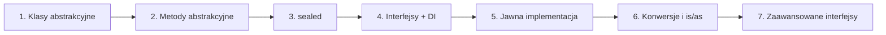
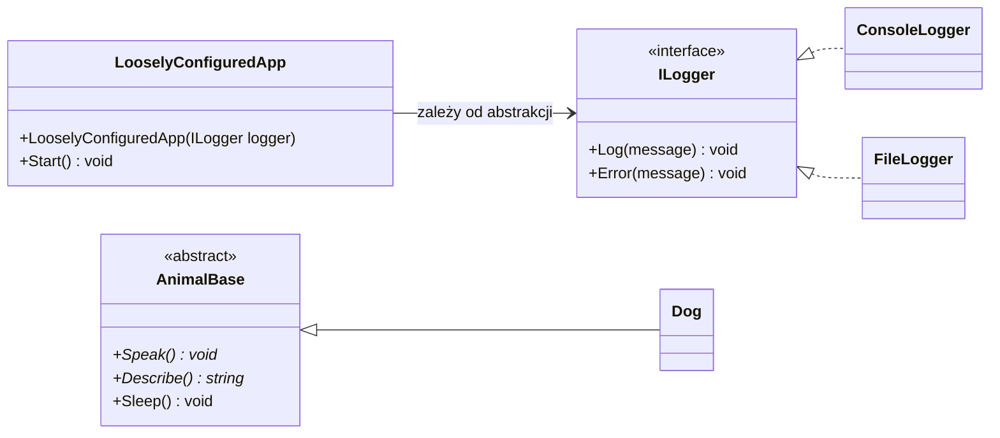
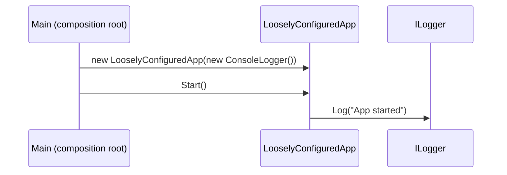

# MODUŁ 07-INTERFEJSY_ABSTRAKCJE: Abstrakcja i Interfejsy w C#

## 📚 Wprowadzenie

Moduł kompleksowo omawia **abstrakcję i interfejsy** - fundamentalne koncepty OOP pozwalające na projektowanie elastycznych, testowalnych systemów.

Od klas abstrakcyjnych, przez interfejsy, aż po nowoczesne C# 8.0+ features.

---

## 📋 Tematy (7 wykładów)

| # | Temat | Opis | Testy (xUnit) |
|---|-------|------|---------------|
| 1 | [Klasy Abstrakcyjne: Wstęp](#temat-1-klasy-abstrakcyjne-wstęp) | abstract, konwencja Base, Shape library | 8 |
| 2 | [Metody Abstrakcyjne](#temat-2-metody-abstrakcyjne) | abstract vs virtual, ograniczenia | 7 |
| 3 | [Sealed Keyword](#temat-3-sealed-keyword) | sealed na klasach, metodach, właściwościach | 6 |
| 4 | [Interfejsy: Wstęp](#temat-4-interfejsy-wstęp) | budowa, DI, loose coupling, C# vs Java | 7 |
| 5 | [Jawna Implementacja](#temat-5-jawna-implementacja-interfejsu) | implicit/explicit, gdy używać | 6 |
| 6 | [Konwersje Operatory](#temat-6-konwersje-i-operatory-castingu) | (), is, as, pattern matching | 8 |
| 7 | [Zaawansowane Interfejsy](#temat-7-zaawansowane-interfejsy) | default members (C# 8.0), static abstract (C# 11) | 7 |

---

## 🎯 Topologia Nauki

```
Temat 1: Klasy Abstrakcyjne (fundament)
    ↓
Temat 2: Metody Abstrakcyjne (vs virtual)
    ↓
Temat 3: Sealed Keyword (kontrola dziedziczenia)
    ↓
Temat 4: Interfejsy (kontrakt, DI)
    ↓
Temat 5: Jawna Implementacja (zaawansowane)
    ↓
Temat 6: Konwersje (is, as, pattern matching)
    ↓
Temat 7: Zaawansowane Interfejsy (C# 8.0+, 11+)
```

Ta sama zależność w formie diagramu Mermaid:



Diagram zależności między klasami i interfejsami (wspólny motyw modułu):



---

## 📖 Szczegóły Tematów

### Temat 1: Klasy Abstrakcyjne - Wstęp

**Kategoria**: Fundamenty

**Kluczowe Koncepty**:
- Słowo kluczowe `abstract`
- Konwencja nazewnictwa: `Base`
- Metody konkretne i abstrakcyjne w klasie abstrakcyjnej
- Polimorfizm z klasami abstrakcyjnymi

**Gdzie**: [`_01_abstract_classes_intro/`](_01_abstract_classes_intro/)

**Przykłady**:
- Animal hierarchy (Dog, Cat)
- Shape library (Circle, Rectangle, Triangle - geometria!)
- Payment processing (CreditCard, PayPal)

**Testy**: 8 xUnit facts

---

### Temat 2: Metody Abstrakcyjne

**Kategoria**: Ograniczenia i kontrakty

**Kluczowe Koncepty**:
- Abstrakcyjna metoda = tylko sygnatura, brak implementacji
- MUSZĄ być implementowane w podklasach
- Abstract vs Virtual - różnice
- Łańcuch abstrakcji (chain of abstractions)

**Gdzie**: [`_02_abstract_methods/`](_02_abstract_methods/)

**Przykłady**:
- Payment processing (Process())
- Document operations (Open, Save, Close)
- Repository pattern (Add, Remove, GetById)

**Testy**: 7 xUnit facts

---

### Temat 3: Sealed Keyword

**Kategoria**: Kontrola dziedziczenia

**Kluczowe Koncepty**:
- `sealed class` - niemożna dziedziczyć
- `sealed override` - niemożna override'ować
- Security-critical operations
- Performance considerations

**Gdzie**: [`_03_sealed_keyword/`](_03_sealed_keyword/)

**Przykłady**:
- Sealed classes (SpecialOffer)
- Sealed methods (Validate() w PdfDocument)
- Encryption classes (AES, security)

**Testy**: 6 xUnit facts

---

### Temat 4: Interfejsy - Wstęp

**Kategoria**: Dependency Injection, Loose Coupling

**Kluczowe Koncepty**:
- Interfejs = kontrakt, WSZYSTKIE elementy public
- C# interfejsy vs Java interfejsy
- Dependency Injection (DI)
- Loose coupling vs tight coupling
- Polimorfizm z interfejsami

**Gdzie**: [`_04_interfaces_intro/`](_04_interfaces_intro/)

**Kod**:
```csharp
// ✅ DI - loose coupling (kod z _04_interfaces_intro/code/Program.cs)
public class LooselyConfiguredApp
{
    private readonly ILogger _logger;

    public LooselyConfiguredApp(ILogger logger)  // Constructor injection
    {
        _logger = logger;
    }

    public void Start() => _logger.Log("App started");
}

// ✅ Można łatwo podmienić implementację
var app1 = new LooselyConfiguredApp(new ConsoleLogger());
var app2 = new LooselyConfiguredApp(new FileLogger());
```

> 💡 **Wzorzec:** klasa nie tworzy własnych zależności (`new ConsoleLogger()` w środku),
> tylko dostaje je z zewnątrz. Miejsce, w którym składa się obiekty, nazywa się *composition root*.



**Testy**: 7 xUnit facts

---

### Temat 5: Jawna Implementacja Interfejsu

**Kategoria**: Zaawansowane techniki

**Kluczowe Koncepty**:
- Implicit implementation (public)
- Explicit implementation (IInterface.Method)
- Kiedy używać explicit
- Różne implementacje dla tej samej metody

**Gdzie**: [`_05_explicit_implementation/`](_05_explicit_implementation/)

**Kod**:
```csharp
public class AnimatedShape : IShapable, IAnimatable
{
    // ✅ Implicit - dla IShapable
    public void Draw() { }
    
    // ✅ Explicit - dla IAnimatable
    void IAnimatable.Draw() { }
    
    // Dostęp:
    shape.Draw();              // IShapable
    ((IAnimatable)shape).Draw(); // IAnimatable
}
```

**Testy**: 6 xUnit facts

---

### Temat 6: Konwersje i Operatory Castingu

**Kategoria**: Type Safety, Pattern Matching

**Kluczowe Koncepty**:
- Cast operator `()`  - throws if wrong
- `is` operator - safe type check
- `as` operator - safe cast, returns null
- Pattern matching (C# 7.0+)
- Not pattern (C# 9.0+)

**Gdzie**: [`_06_casting_operators/`](_06_casting_operators/)

**Kod**:
```csharp
// ✅ Pattern matching with cast (modern!)
if (animal is Dog dog)
{
    dog.Fetch();
}

// ✅ Not pattern
if (animal is not Cat) { }
```

**Testy**: 8 xUnit facts

---

### Temat 7: Zaawansowane Interfejsy (C# 8.0+)

**Kategoria**: Nowoczesne C#

**Kluczowe Koncepty**:
- Default interface members (C# 8.0)
- Static abstract members (C# 11)
- Access modifiers (C# 8.0: private/protected/internal w interfejsie)
- Interface versioning (backward compatibility)

**Gdzie**: [`_07_advanced_interfaces/`](_07_advanced_interfaces/)

**Kod**:
```csharp
// ✅ C# 8.0+: Default implementation
public interface ILogger
{
    void Log(string msg);
    
    public void LogInfo(string info)
    {
        Console.WriteLine($"[INFO] {info}");
    }
}

// ✅ C# 11+: Static abstract
public interface IConverter
{
    static abstract double Convert(double value);
}

// ✅ C# 8.0+: Private methods
public interface IService
{
    private void LogInternal(string msg) { }
}
```

**Testy**: 7 xUnit facts

---

## 🛠️ Jak Pracować

### Dla każdego tematu:

```bash
# 1. Wejdź do katalogu kodu
cd _01_abstract_classes_intro/code/

# 2. Uruchom testy (tematy 1–6 zawierają testy xUnit, nie metodę Main)
dotnet test

# 3. Uruchom demonstrację (tylko temat 7 ma Main z pokazami)
dotnet run   # w _07_advanced_interfaces/code/

# 4. Otwórz kod w VS Code
code Program.cs
```

### Struktura projektu:

```
07-interfejsy_abstrakcje/
├── README.md                        # Ten plik
├── STATUS.md                        # Stan przygotowania modułu
├── _01_abstract_classes_intro/
│   ├── README.md
│   ├── code/
│   │   ├── *.csproj
│   │   └── Program.cs              # Klasy + testy xUnit
│   ├── diagrams/
│   │   └── class_hierarchy.md      # Diagramy Mermaid
│   └── tasks/
│       └── README.md               # Zadania dla studentów
├── _02_abstract_methods/
│   ├── README.md
│   └── code/
├── _03_sealed_keyword/
│   ├── README.md
│   └── code/
├── _04_interfaces_intro/
│   ├── README.md
│   ├── code/
│   ├── diagrams/dependency_injection.md
│   └── tasks/
├── _05_explicit_implementation/
│   ├── README.md
│   └── code/
├── _06_casting_operators/
│   ├── README.md
│   └── code/
└── _07_advanced_interfaces/        # code/ (z Main i demo)
    ├── README.md
    └── code/
```

> Każdy temat ma własne `README.md`. Diagramy i zadania dla studentów istnieją tylko tam, gdzie wskazano powyżej.
> Stan szczegółowy opisuje [STATUS.md](STATUS.md).


---

## 🔧 Technologia

| Komponent | Wersja | Dlaczego |
|-----------|--------|---------|
| .NET SDK | 9.0 | Projekty targetują net9.0 |
| C# | latest (domyślnie dla net9.0) | Default interface members (C# 8.0), static abstract (C# 11) |
| xUnit | 2.6.6 | Standardowy framework testów |
| Nullable | enable | Strict null checking |

---

## 📊 Statystyka Modułu

| Metrika | Wartość |
|---------|---------|
| Tematy | 7 |
| Pliki README tematów | 7 (po jednym w każdym temacie) + README główny |
| Projekty `.csproj` | 7 (wszystkie net9.0) |
| Testy xUnit (`[Fact]`) | 49 (8 + 7 + 6 + 7 + 6 + 8 + 7) |
| Diagramy Mermaid | `_01/diagrams/class_hierarchy.md`, `_04/diagrams/dependency_injection.md` |

---

## 🎓 Oczekiwane Efekty Uczenia

Po ukończeniu tego modułu student powinien:

- [ ] Projektować klasy abstrakcyjne (`abstract`)
- [ ] Rozumieć konwencję `Base` w nazewnictwie
- [ ] Implementować metody abstrakcyjne
- [ ] Znać różnicę między `abstract` a `virtual`
- [ ] Używać `sealed` do kontroli dziedziczenia
- [ ] Projektować interfejsy (kontrakt)
- [ ] Wdrażać DI (Dependency Injection)
- [ ] Rozumieć loose coupling
- [ ] Implementować jawnie interfejsy (`IInterface.Method`)
- [ ] Używać operatorów castingu (`()`, `is`, `as`)
- [ ] Pracować z pattern matching (C# 7.0+)
- [ ] Wdrażać C# 8.0+ default interface members
- [ ] Wdrażać C# 11+ static abstract members
- [ ] Projektować wersjonowane interfejsy (backward compatibility)

---

## 📚 Referencje i Zasoby

### Microsoft Learn
- [Abstract Classes and Sealed Classes](https://learn.microsoft.com/en-us/dotnet/csharp/fundamentals/types/abstract)
- [Interfaces](https://learn.microsoft.com/en-us/dotnet/csharp/fundamentals/types/interfaces)
- [Default Interface Members](https://learn.microsoft.com/en-us/dotnet/csharp/tutorials/default-interface-members-versions)
- [Pattern Matching](https://learn.microsoft.com/en-us/dotnet/csharp/fundamentals/functional/pattern-matching)

### Wideo/Kursy
- [Microsoft Learn: OOP Concepts](https://learn.microsoft.com/en-us/training/modules/object-oriented-programming-csharp/)

### Książki
- **C# Player's Guide** - RB Whitaker (Chapt. 19-21)
- **CLR via C#** - Jeffrey Richter (Chapt. 12: Interfaces)
- **Dependency Injection Principles, Practices, and Patterns** - Steven van Deursen, Mark Seemann

---

## ✅ Checklist dla Nauczycieli

Przed pierwszym wykładem:

- [ ] Przeczytaj README każdego tematu
- [ ] Uruchom `dotnet test` w każdym temacie (demo `dotnet run` jest tylko w temacie 7)
- [ ] Przejrzyj diagramy (Mermaid)
- [ ] Przygotuj pytania do studentów
- [ ] Test projektor/HDMI
- [ ] Przygotuj live-coding examples
- [ ] Skopiuj zadania do LMS (jeśli używasz)

---

## ✅ Checklist dla Studentów

Po każdym temacie:

- [ ] Przeczytałem README.md
- [ ] Rozumiem koncepty i diagramy
- [ ] Zagrałem demo (`dotnet run`, temat 7) lub przejrzałem testy (`dotnet test`, tematy 1–6)
- [ ] Analizowałem kod w detail
- [ ] Zrobiłem przynajmniej 2 zadania
- [ ] Uruchomiłem testy (`dotnet test`)
- [ ] Mogę wyjaśnić główne koncepty
- [ ] Widzę praktyczne zastosowania

---

## 🚀 Quick Start

```bash
# Temat 1: Abstract Classes
cd _01_abstract_classes_intro/code
dotnet test

# Temat 4: Interfaces
cd ../../_04_interfaces_intro/code
dotnet test

# Temat 7: Demo + testy
cd ../../_07_advanced_interfaces/code
dotnet run
dotnet test
```

---

## 💡 Porównanie Z Poprzednimi Modułami

Porównanie z modułami 05 i 06 wymaga osobnej weryfikacji i zostało usunięte z tej wersji dokumentu.

---

## 🏆 Podsumowanie

**Moduł 07-Interfejsy_Abstrakcje to zestaw materiałów edukacyjnych** do nauczania abstrakcji, interfejsów i nowoczesnych C# features.

- ✅ **7 tematów** od podstaw do zaawansowanych koncepcji
- ✅ **49 testów** xUnit
- ✅ **Real-world example**: Shape library, Payment system, DI
- ✅ **Nowoczesne C# 8.0+** features (default interface members)
- ✅ **C# 11+ features** (static abstract members, private methods)
- ✅ **Design patterns**: DI, Loose coupling, Repository
- ✅ **Gotowy do użycia** w nauczaniu

**Status**: 🟢 **GOTOWY DO NAUCZANIA**

---

## 📝 Historia Zmian

- **2024-08-30**: v1.0 - Moduł kompletny, 7 tematów, wszystkie budują ✅

---

*Stworzone dla uniwersytetu, nauczycieli i studentów C#*

*Ostatnia aktualizacja: 2024-08-30*
