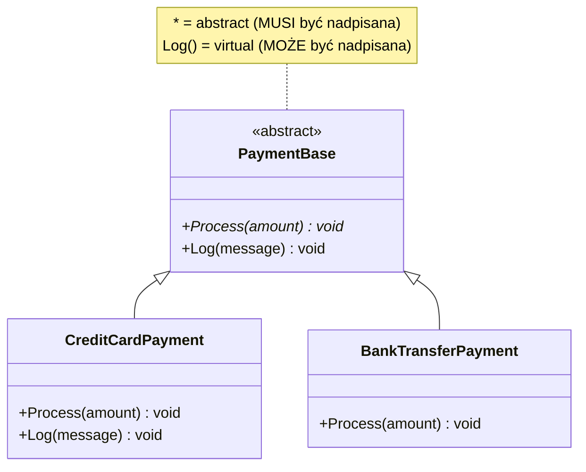
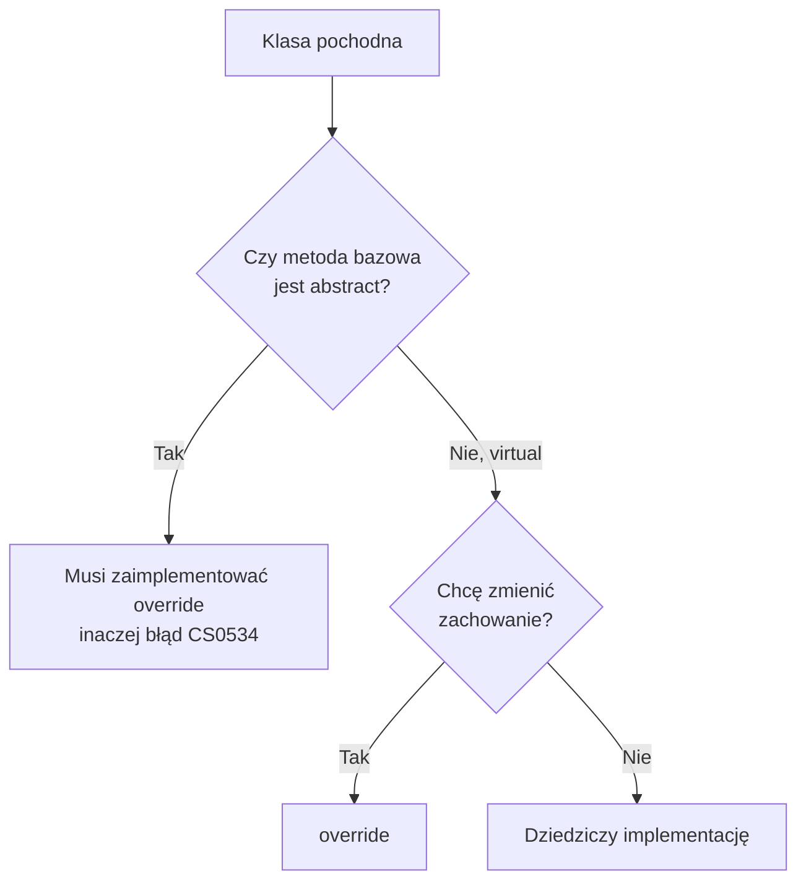

# TEMAT 2: Metody Abstrakcyjne

## 📖 Wprowadzenie

**Metoda abstrakcyjna** to metoda, która ma tylko **sygnaturę**, bez ciała. Deklaruje *co* klasa potrafi, ale nie mówi *jak*. Każda konkretna klasa pochodna **musi** ją zaimplementować (`override`).

Porównaj z metodą wirtualną, która ma domyślną implementację i może, ale nie musi, zostać nadpisana.

```
┌────────────────────────────────────────────────────────┐
│ PaymentBase (abstract)                                 │
├────────────────────────────────────────────────────────┤
│ + Process(amount)     { abstract }  ← brak ciała       │  MUSI być override
│ + Log(message)        { virtual }   ← ma ciało         │  MOŻE być override
└────────────────────────────────────────────────────────┘
          ▲                                  ▲
          │                                  │
  CreditCardPayment                 BankTransferPayment
  override Process()                override Process()
  (Log dziedziczony)                override Log() (opcjonalnie)
```

---

## 🎯 Kluczowe Koncepty

### 1. Abstrakcyjna metoda = kontrakt bez implementacji

```csharp
public abstract class PaymentBase
{
    public abstract void Process(decimal amount);   // tylko sygnatura, średnik zamiast {}
}
```

Próba dodania ciała kończy się błędem kompilacji:

```csharp
// public abstract void Process(decimal amount) { }  // ❌ CS0500
```

### 2. Abstract vs Virtual

| Cecha | `abstract` | `virtual` |
|-------|-----------|-----------|
| Ciało metody | Brak | Jest |
| Czy podklasa **musi** nadpisać? | ✅ Tak | ❌ Nie |
| Czy klasa może być utworzona z tą metodą? | ❌ Klasa musi być `abstract` | ✅ Tak |
| Czy można wywołać `base.Metoda()`? | ❌ Nie | ✅ Tak |

### 3. Abstrakcyjne właściwości

Właściwość również może być abstrakcyjna. Podklasa musi dostarczyć `get` (i `set`, jeśli jest zadeklarowany):

```csharp
public abstract class RepositoryBase<T>
{
    public abstract int Count { get; }
}
```

### 4. Modyfikatory, których nie wolno łączyć z `abstract`

- `private` — metoda prywatna nie byłaby widoczna dla podklasy, więc nie mogłaby zostać nadpisana
- `static` — metody statyczne nie są polimorficzne
- `sealed` — `sealed` zabrania nadpisania, `abstract` tego wymaga

---

## 💻 Praktyczne Przykłady

### Przykład 1: Dokumenty — łańcuch abstrakcji

`DocumentBase` definiuje kontrakt, a klasy `PdfDocument` i `WordDocument` dostarczają implementacje:

```csharp
public abstract class DocumentBase
{
    public abstract void Open();
    public abstract void Save();
    public abstract void Close();
    public abstract string GetContent();
    public abstract void FindAndReplace(string find, string replace);
}

public class PdfDocument : DocumentBase
{
    private string _content = "";

    public override void Open()  { /* otwórz plik PDF */ }
    public override void Save()  { /* zapisz w formacie PDF */ }
    public override void Close() { /* zwolnij zasoby */ }
    public override string GetContent() => _content;
    public override void FindAndReplace(string find, string replace)
        => _content = _content.Replace(find, replace);
}
```

Dzięki temu kod kliencki może obsłużyć dowolny dokument jednym typem:

```csharp
DocumentBase doc = new PdfDocument();
doc.Open();
doc.FindAndReplace("draft", "final");
doc.Save();
doc.Close();
```

### Przykład 2: Repozytorium generyczne

Klasa abstrakcyjna może łączyć metody publiczne, chronione oraz abstrakcyjną właściwość:

```csharp
public abstract class RepositoryBase<T>
{
    public abstract void Add(T item);
    public abstract void Remove(T item);
    public abstract T? GetById(int id);
    public abstract List<T> GetAll();

    protected abstract void ValidateItem(T item);   // tylko dla podklas

    public abstract int Count { get; }
}

public class UserRepository : RepositoryBase<string>
{
    private readonly List<string> _users = new();

    public override void Add(string item)
    {
        ValidateItem(item);
        _users.Add(item);
    }

    public override void Remove(string item) => _users.Remove(item);
    public override string? GetById(int id) => id >= 0 && id < _users.Count ? _users[id] : null;
    public override List<string> GetAll() => new(_users);
    public override int Count => _users.Count;

    protected override void ValidateItem(string item)
    {
        if (string.IsNullOrWhiteSpace(item))
            throw new ArgumentException("Nazwa użytkownika nie może być pusta");
    }
}
```

### Przykład 3: Metoda wirtualna — kiedy wystarczy domyślne zachowanie

```csharp
public abstract class PaymentBase
{
    public abstract void Process(decimal amount);

    public virtual void Log(string message)
        => Console.WriteLine($"[LOG] {message}");   // domyślna implementacja
}

public class CreditCardPayment : PaymentBase
{
    public override void Process(decimal amount)
    {
        Log($"Obciążam kartę na {amount:C}");
        // ... logika płatności kartą
    }

    public override void Log(string message)
        => Console.WriteLine($"[CARD] {message}");  // opcjonalne nadpisanie
}
```

### Przykład 4: Łańcuch abstrakcji (klasa abstrakcyjna dziedzicząca po abstrakcyjnej)

```csharp
public abstract class DocumentWithState
{
    public abstract void Save();
    public abstract void Load();

    public virtual void PrintInfo() => Console.WriteLine("Dokument");
}
```

Klasa pochodna musi implementować wszystkie abstrakcyjne metody z całego łańcucha.

---

## 📊 Diagram: Abstract vs Virtual





---

## ⚡ Ograniczenia i Reguły

1. **Klasa z abstrakcyjną metodą musi być `abstract`** — kompilator zgłosi CS0513 w przeciwnym razie.
2. **Klasa abstrakcyjna nie może być utworzona** — `new PaymentBase()` jest błędem.
3. **Podklasa musi nadpisać wszystkie abstrakcyjne członki** — albo sama być `abstract`.
4. **Abstrakcyjna metoda nie może być `private` ani `static`.**

---

## 🔑 Kluczowe Punkty

- `abstract` wymusza implementację w podklasie, `virtual` tylko ją dopuszcza
- Abstrakcyjne mogą być metody, właściwości i zdarzenia
- Łańcuch abstrakcji przenosi obowiązek implementacji na kolejne poziomy
- Metody abstrakcyjne są podstawą wzorca *Template Method* (klasa bazowa definiuje kroki, podklasy je wypełniają)

---

## ▶️ Uruchomienie

```bash
cd code
dotnet test
```

Projekt zawiera **7 testów xUnit** (`[Fact]`).

---

## 📚 Referencje

- [Abstract classes and class members (Microsoft Learn)](https://learn.microsoft.com/en-us/dotnet/csharp/fundamentals/types/abstract)
- [virtual (C# Reference)](https://learn.microsoft.com/en-us/dotnet/csharp/language-reference/keywords/virtual)

---

## ✅ Efekty Uczenia

Po tym temacie student potrafi:

- [ ] Zadeklarować metodę i właściwość abstrakcyjną
- [ ] Wyjaśnić różnicę między `abstract` a `virtual`
- [ ] Zaimplementować łańcuch klas abstrakcyjnych
- [ ] Wskazać, kiedy kompilator wymusi nadpisanie członka
