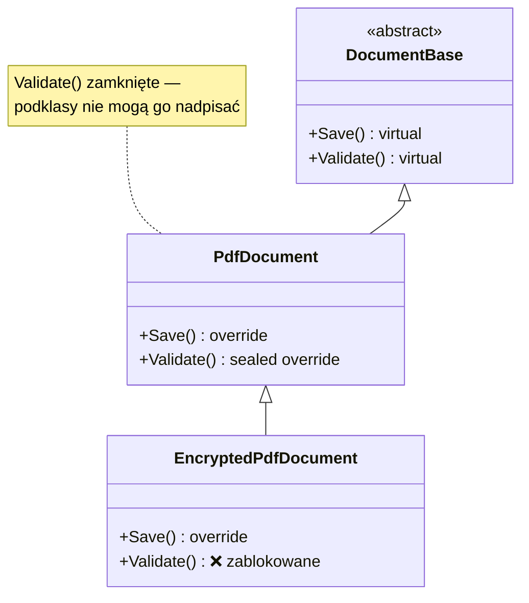
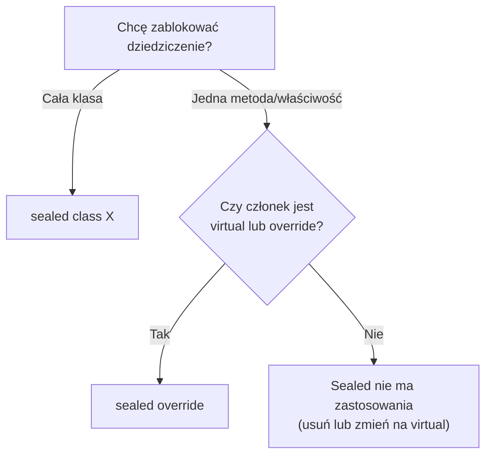

# TEMAT 3: Słowo kluczowe `sealed`

## 📖 Wprowadzenie

**`sealed`** (zapieczętowany) oznacza, że dalsze dziedziczenie lub nadpisywanie jest **zabronione**. Można go zastosować w dwóch miejscach:

- **na klasie** — `sealed class X` — nikt nie może po niej dziedziczyć,
- **na metodzie, właściwości lub zdarzeniu** — `sealed override` — klasa pochodna *może* nadpisać członka, ale jej **dalsze** podklasy już nie.

Słowo kluczowe pozwala autorowi klasy powiedzieć: „ta część zachowania jest ostateczna, nie zmieniaj jej”.

```
DocumentBase (abstract)
│   virtual Save()
│   virtual Validate()
│
└── PdfDocument
    │   override Save()
    │   sealed override Validate()   ← koniec: niżej nie wolno nadpisać
    │
    └── EncryptedPdfDocument
            override Save()          ✅ dozwolone
            override Validate()      ❌ CS0239 — Validate jest sealed
```

---

## 🎯 Kluczowe Koncepty

### 1. `sealed class` — zamknięcie całej hierarchii

```csharp
public sealed class SpecialOffer
{
    public string Description { get; init; } = "";
    public decimal Discount { get; init; }
}

// public class SuperOffer : SpecialOffer { }   // ❌ CS0509
```

Klasa `sealed` nadal może być tworzona, a jej instancje działają normalnie. Zabronione jest tylko dziedziczenie.

### 2. `sealed override` — zamknięcie pojedynczego członka

Wzorzec działa tylko dla członków, które są już `virtual` lub `override`:

```csharp
public class PdfDocument : DocumentBase
{
    public sealed override void Validate()
    {
        Console.WriteLine("Walidacja PDF — nie do nadpisania");
    }
}
```

Bez `sealed` na `override` każda klasa pochodna mogłaby nadpisać `Validate` ponownie.

### 3. Kiedy kompilator wymusza `sealed`

- Klasy z `private` konstruktorem (np. singleton) często są `sealed`, bo nie da się ich bezpiecznie dziedziczyć.
- Klasy, które zwracają wrażliwe dane lub stosują walidację wymagającą pełnej kontroli.

---

## 💻 Praktyczne Przykłady

### Przykład 1: Klasa `sealed` — model domenowy

```csharp
public sealed class SpecialOffer
{
    public string Code { get; }
    public decimal Discount { get; }

    public SpecialOffer(string code, decimal discount)
    {
        Code = code;
        Discount = discount;
    }
}

var offer = new SpecialOffer("LATO2025", 0.15m);   // ✅ tworzenie działa
// class Promo : SpecialOffer { }                  // ❌ nie da się dziedziczyć
```

### Przykład 2: Łańcuch `virtual` → `override` → `sealed override`

```csharp
public abstract class DocumentBase
{
    public virtual void Save()     => Console.WriteLine("Zapis (bazowy)");
    public virtual void Validate() => Console.WriteLine("Walidacja (bazowa)");
}

public class PdfDocument : DocumentBase
{
    public override void Save()    => Console.WriteLine("Zapis PDF");
    public sealed override void Validate()
        => Console.WriteLine("Walidacja PDF (ostateczna)");
}

public class EncryptedPdfDocument : PdfDocument
{
    public override void Save()    => Console.WriteLine("Zapis zaszyfrowanego PDF");

    // public override void Validate() { }   // ❌ CS0239: Validate jest sealed
}
```

Wywołanie przez typ bazowy pokazuje, że `Validate` zawsze trafia do implementacji `PdfDocument`:

```csharp
DocumentBase doc = new EncryptedPdfDocument();
doc.Save();       // "Zapis zaszyfrowanego PDF"  (polimorfizm)
doc.Validate();   // "Walidacja PDF (ostateczna)" (sealed — jedna wersja na całej gałęzi)
```

### Przykład 3: `sealed override` na właściwości

```csharp
public abstract class ConfigBase
{
    public abstract string AppName { get; }
}

public class AppConfig : ConfigBase
{
    public sealed override string AppName => "MyApp";
}
```

Klasy pochodne od `AppConfig` nie mogą zmienić nazwy aplikacji.

### Przykład 4: Szyfrowanie — klucz zamknięty na poziomie `AesEncryption`

```csharp
public abstract class CryptoBase
{
    public abstract string Encrypt(string data);
    public virtual void ResetKey() { /* ... */ }
}

public class AesEncryption : CryptoBase
{
    public override string Encrypt(string data) => $"AES({data})";

    // Reset klucza ma być kontrolowany tylko tutaj
    public sealed override void ResetKey() => Console.WriteLine("Klucz zresetowany");
}

public class SpecialAesEncryption : AesEncryption
{
    public override string Encrypt(string data) => $"AES-special({data})";
    // public override void ResetKey() { }   // ❌ sealed
}
```

### Przykład 5: Singleton-podobna klasa

```csharp
public sealed class SingletonLike
{
    private static SingletonLike? _instance;
    private SingletonLike() { }

    public static SingletonLike Instance => _instance ??= new SingletonLike();
}

// public class Derived : SingletonLike { }   // ❌ nie da się — konstruktor prywatny i klasa sealed
```

Oba mechanizmy blokują dziedziczenie. `sealed` czyni to jawnym, a prywatny konstruktor chroni przed utworzeniem instancji spoza klasy.

---

## 📊 Diagram: Gdzie można użyć `sealed`





---

## ⚡ Ograniczenia i Reguły

1. **`sealed` nie może być użyte razem z `abstract`** na tej samej klasie — klasa abstrakcyjna jest zaprojektowana do dziedziczenia.
2. **`sealed` na członku wymaga `override`** — samo `sealed` na zwykłej metodzie jest błędem (CS0238).
3. **Klasa `sealed` nie może mieć członków `protected`** — nie ma kogo chronić przed dziedziczeniem (kompilator ostrzega).
4. **Nie da się zdjąć `sealed` w podklasie** — ograniczenie działa dla całej gałęzi poniżej miejsca deklaracji.

---

## 🔑 Kluczowe Punkty

- `sealed class` blokuje dziedziczenie po całej klasie
- `sealed override` blokuje nadpisanie jednego członka w dalszych podklasach
- Słowo kluczowe wyraża **intencję projektową** i chroni niezmienniki
- Kompilator i JIT mogą lepiej optymalizować wywołania metod w klasach `sealed` (brak wirtualnej dyspozycji)

---

## ▶️ Uruchomienie

```bash
cd code
dotnet test
```

Projekt zawiera **6 testów xUnit** (`[Fact]`).

---

## 📚 Referencje

- [sealed (C# Reference)](https://learn.microsoft.com/en-us/dotnet/csharp/language-reference/keywords/sealed)
- [Inheritance (Microsoft Learn)](https://learn.microsoft.com/en-us/dotnet/csharp/fundamentals/object-oriented/inheritance)

---

## ✅ Efekty Uczenia

Po tym temacie student potrafi:

- [ ] Zablokować dziedziczenie po klasie za pomocą `sealed`
- [ ] Zastosować `sealed override`, aby zamknąć pojedynczy członek
- [ ] Wskazać, który błąd kompilacji pojawi się przy próbie nadpisania zamkniętego członka
- [ ] Uzasadnić, kiedy warto zamknąć klasę lub metodę
