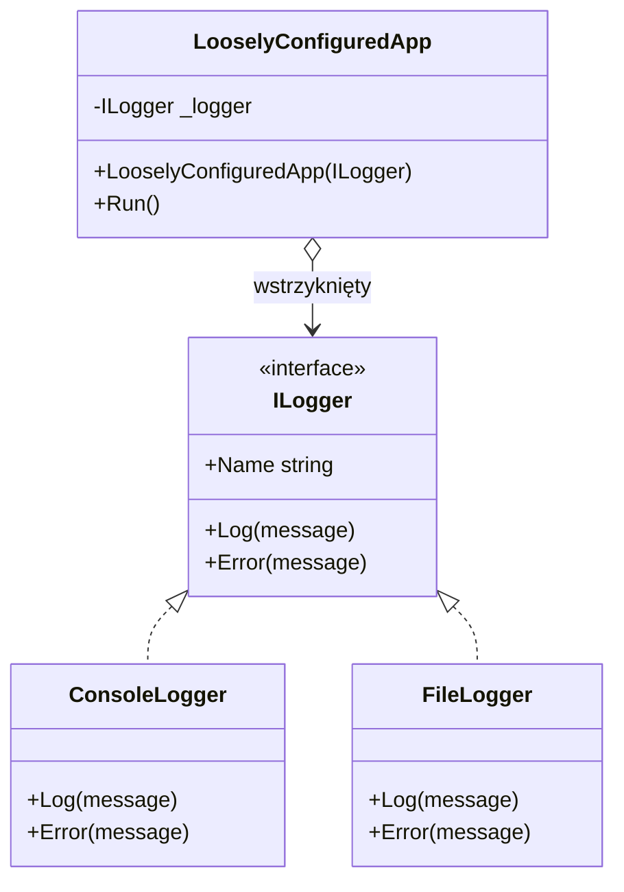
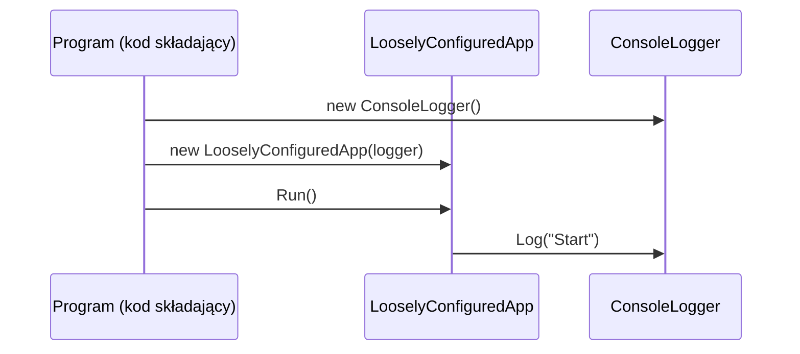

# TEMAT 4: Interfejsy jako wstrzykiwanie zależności

## 📖 Wprowadzenie

Interfejs definiuje **kontrakt**, a klasa go implementuje. Gdy klasa wysokiego poziomu (np. serwis biznesowy) zależy od interfejsu, a nie od konkretnej klasy, może działać z **dowolną implementacją**. Zmiana implementacji nie wymaga zmiany kodu, który z niej korzysta.

Taka zależność nazywa się **luźnym sprzężeniem** (loose coupling). Przeciwieństwem jest **ścisłe sprzężenie** (tight coupling), gdy klasa sama tworzy konkretne obiekty przez `new`.

```
ŚCISŁE SPRZĘŻENIE                      LUŹNE SPRZĘŻENIE (DI)

┌──────────────┐                       ┌──────────────┐
│ DataService  │                       │ DataService  │
│  new Database│──► DatabaseRepo       │  IRepository │◄── wstrzyknięty
└──────────────┘                       └──────┬───────┘
                                              │ implementuje
                                  ┌───────────┴───────────┐
                             DatabaseRepo            FileRepo
```

---

## 🎯 Kluczowe Koncepty

### 1. Problem: klasa tworzy swoje zależności

```csharp
public class TightlyCoupledApp
{
    private readonly ConsoleLogger _logger = new();   // zależność na sztywno

    public void Run() => _logger.Log("Start");
}
```

Zmiana logowania do pliku wymaga edycji `TightlyCoupledApp`.

### 2. Rozwiązanie: zależność przez konstruktor

```csharp
public class LooselyConfiguredApp
{
    private readonly ILogger _logger;

    public LooselyConfiguredApp(ILogger logger)
        => _logger = logger;

    public void Run() => _logger.Log("Start");
}
```

Konkretny logger wybiera **kod składający** (composition root), nie klasa `LooselyConfiguredApp`.

### 3. Interfejs jako granica

```csharp
public interface ILogger
{
    string Name { get; }
    void Log(string message);
    void Error(string message);
}
```

Każda implementacja (`ConsoleLogger`, `FileLogger`) wypełnia ten kontrakt inaczej, ale klient widzi tylko `ILogger`.

### 4. Wstrzykiwanie w praktyce

```csharp
var app1 = new LooselyConfiguredApp(new ConsoleLogger());
var app2 = new LooselyConfiguredApp(new FileLogger("app.log"));
```

Ta sama klasa `LooselyConfiguredApp` działa z dwoma różnymi loggerami.

---

## 💻 Praktyczne Przykłady

### Przykład 1: Repozytorium zależne od interfejsu

```csharp
public interface IRepository
{
    void Save(string data);
    string Load();
}

public class DatabaseRepository : IRepository
{
    public void Save(string data) => Console.WriteLine($"[DB] INSERT: {data}");
    public string Load() => "dane z bazy";
}

public class FileRepository : IRepository
{
    private readonly string _path;
    public FileRepository(string path) => _path = path;

    public void Save(string data) => File.WriteAllText(_path, data);
    public string Load() => File.ReadAllText(_path);
}
```

Serwis biznesowy nie wie, gdzie są dane:

```csharp
public class DataService
{
    private readonly IRepository _repository;

    public DataService(IRepository repository) => _repository = repository;

    public void Import(string raw)
    {
        var cleaned = raw.Trim();
        _repository.Save(cleaned);
    }
}
```

Testy mogą podać atrapę (*fake*) zamiast prawdziwej bazy:

```csharp
public class InMemoryRepository : IRepository
{
    private string _data = "";
    public void Save(string data) => _data = data;
    public string Load() => _data;
}

var service = new DataService(new InMemoryRepository());
service.Import("  test  ");
```

### Przykład 2: Procesory płatności w sklepie

```csharp
public interface IPaymentProcessor
{
    bool Pay(decimal amount);
}

public class StripeProcessor : IPaymentProcessor
{
    public bool Pay(decimal amount) { /* wywołanie API Stripe */ return true; }
}

public class PayPalProcessor : IPaymentProcessor
{
    public bool Pay(decimal amount) { /* wywołanie API PayPal */ return true; }
}

public class OrderProcessor
{
    private readonly IPaymentProcessor _payment;

    public OrderProcessor(IPaymentProcessor payment) => _payment = payment;

    public bool Checkout(decimal total) => _payment.Pay(total);
}
```

Zmiana dostawcy płatności to jedna linia w miejscu, gdzie tworzysz `OrderProcessor`:

```csharp
var order = new OrderProcessor(new StripeProcessor());
// zmiana dostawcy: new OrderProcessor(new PayPalProcessor())
```

### Przykład 3: Kontener DI (koncepcja)

Frameworki (np. `Microsoft.Extensions.DependencyInjection`) automatyzują składanie obiektów, ale zasada jest ta sama:

```csharp
// Rejestracja: IRepository → FileRepository
services.AddSingleton<IRepository>(new FileRepository("data.txt"));
services.AddTransient<DataService>();

// Kontener sam przekazuje IRepository do konstruktora DataService
```

Ten przykład ilustruje ideę; w tym projekcie składanie zależności robi się ręcznie w testach i `Program.cs`.

---

## 📊 Diagram: Wstrzykiwanie zależności





---

## ⚡ Ograniczenia i Reguły

1. **Interfejs nie może mieć pól instancji** — dane przechowuje implementacja.
2. **Klasa implementuje każdy członek interfejsu** (lub dziedziczy go z klasy bazowej), inaczej błąd CS0535.
3. **Zależność przez konstruktor jest jawna** — widać ją w sygnaturze, co ułatwia testowanie.
4. **Interfejs nie zastępuje dobrego nazewnictwa** — `IRepository` powinien opisywać rolę, nie technologię.

---

## 🔑 Kluczowe Punkty

- Zależność od interfejsu zamiast konkretnej klasy zmniejsza sprzężenie
- Wstrzykiwanie przez konstruktor pozwala podmienić implementację bez zmiany klienta
- Atrapy (*fake*) upraszczają testy jednostkowe
- Kod składający (composition root) to miejsce, gdzie wybierasz konkretne klasy

---

## ▶️ Uruchomienie

```bash
cd code
dotnet test
```

Projekt zawiera **7 testów xUnit** (`[Fact]`).

---

## 📚 Referencje

- [Dependency injection in .NET (Microsoft Learn)](https://learn.microsoft.com/en-us/dotnet/core/extensions/dependency-injection)
- [Interfaces (C# Programming Guide)](https://learn.microsoft.com/en-us/dotnet/csharp/fundamentals/types/interfaces)

---

## ✅ Efekty Uczenia

Po tym temacie student potrafi:

- [ ] Wyjaśnić różnicę między luźnym a ścisłym sprzężeniem
- [ ] Wstrzyknąć zależność przez konstruktor
- [ ] Podmienić implementację interfejsu bez zmiany klienta
- [ ] Przygotować atrapę interfejsu na potrzeby testu
