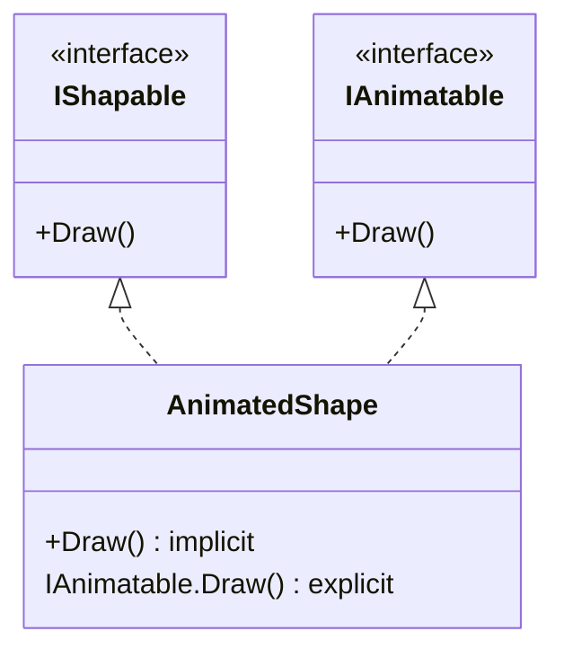
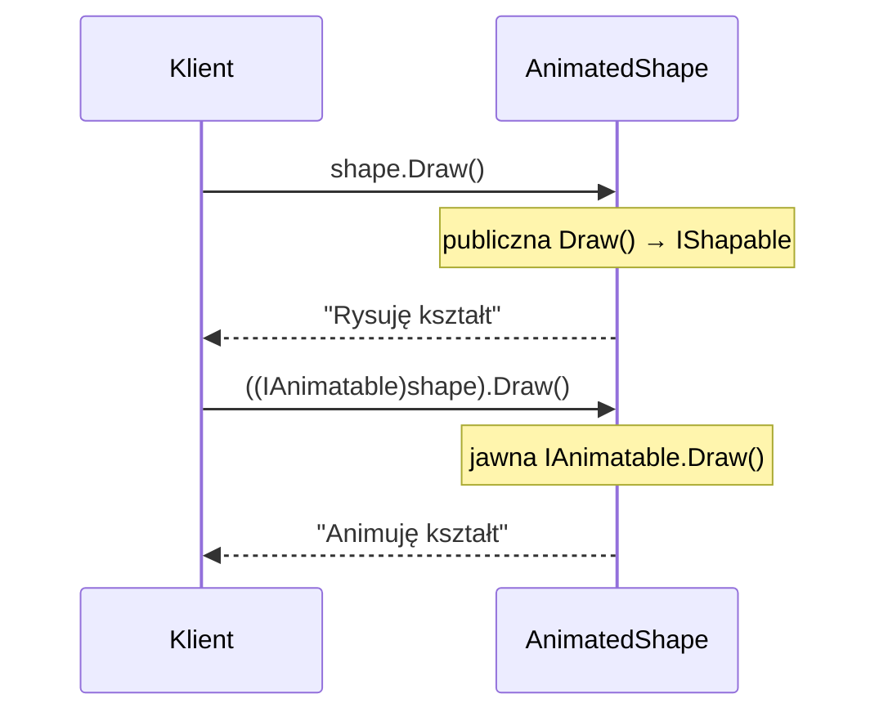

# TEMAT 5: Jawna implementacja interfejsu (Explicit Implementation)

## 📖 Wprowadzenie

Klasa może implementować kilka interfejsów naraz. Problem pojawia się, gdy dwa interfejsy deklarują **metodę o tej samej sygnaturze**. Jedna metoda `public void Draw()` nie może wtedy spełnić dwóch różnych kontraktów z różnym zachowaniem.

**Jawna implementacja** (explicit implementation) rozwiązuje ten konflikt: członek interfejsu zapisuje się z jego nazwą (`void IAnimatable.Draw()`), bez modyfikatora dostępu. Jest wtedy widoczny **tylko** przez referencję typu interfejsu.

```
AnimatedShape : IShapable, IAnimatable

  ┌──────────────────────────────┐
  │ public void Draw()           │ ◄── implicit: IShapable.Draw
  │ void IAnimatable.Draw()      │ ◄── explicit: widoczny tylko przez IAnimatable
  └──────────────────────────────┘

  var shape = new AnimatedShape();
  shape.Draw();                    // ✅ IShapable.Draw (publiczna)
  shape.IAnimatable.Draw();        // ❌ błąd: brak takiego składnika
  ((IAnimatable)shape).Draw();     // ✅ IAnimatable.Draw (przez rzutowanie)
```

---

## 🎯 Kluczowe Koncepty

### 1. Implicit vs explicit

| Cecha | Implicit | Explicit |
|-------|----------|----------|
| Zapis | `public void Draw()` | `void IAnimatable.Draw()` |
| Modyfikator dostępu | Jawny (`public`) | Brak |
| Widoczność na obiekcie klasy | ✅ Tak | ❌ Nie |
| Widoczność przez interfejs | ✅ Tak | ✅ Tak |
| Może być `virtual`/`override`? | ✅ Tak | ❌ Nie (jest `private` z punktu widzenia klasy) |

### 2. Dostęp do jawnej implementacji wymaga rzutowania

```csharp
IAnimatable animatable = shape;   // przypisanie do typu interfejsu
animatable.Draw();                 // ✅ wywołuje jawną implementację
```

Nie ma składni `shape.IAnimatable.Draw()` — kompilator nie tworzy takiego składnika.

### 3. Wyjątek od reguły: współdzielona nazwa

Gdy zwykła metoda `public` ma tę samą sygnaturę, co metoda interfejsu, może ona zaimplementować obie wersje (implicit). Wtedy oba interfejsy wywołują tę samą metodę. Jawną implementację warto stosować, gdy zachowanie ma być **różne**.

---

## 💻 Praktyczne Przykłady

### Przykład 1: Kształt, który można rysować i animować

```csharp
public interface IShapable
{
    void Draw();
}

public interface IAnimatable
{
    void Draw();   // ta sama nazwa, inne znaczenie
}

public class AnimatedShape : IShapable, IAnimatable
{
    // Implicit — dla IShapable
    public void Draw()
        => Console.WriteLine("Rysuję kształt");

    // Explicit — dla IAnimatable
    void IAnimatable.Draw()
        => Console.WriteLine("Animuję kształt");
}
```

Efekt w kodzie klienta:

```csharp
var shape = new AnimatedShape();

shape.Draw();                      // "Rysuję kształt"

IShapable s = shape;
s.Draw();                          // "Rysuję kształt"

IAnimatable a = shape;
a.Draw();                          // "Animuję kształt"
```

### Przykład 2: Płatność jako UI i animacja

Ten sam wzorzec w bardziej praktycznym kontekście — komponent płatności jest zarówno elementem interfejsu użytkownika, jak i animacji:

```csharp
public class PaymentMethod : IShapable, IAnimatable
{
    public void Draw()                  // IShapable.Draw
        => Console.WriteLine("[Payment] Rysuję formularz płatności");

    void IAnimatable.Draw()             // IAnimatable.Draw
        => Console.WriteLine("[Animation] Animuję przycisk płatności");
}
```

### Przykład 3: Dwa interfejsy API o tej samej metodzie

Klasa może udostępniać różne API zależnie od tego, przez jaki interfejs ją widzi klient:

```csharp
public interface IPublicApi   { void UtilityMethod(); }
public interface IInternalApi { void UtilityMethod(); }

public class ApiImpl : IPublicApi, IInternalApi
{
    void IPublicApi.UtilityMethod()   => Console.WriteLine("Publiczne narzędzie");
    void IInternalApi.UtilityMethod() => Console.WriteLine("Wewnętrzne narzędzie");
}

// Klient zewnętrzny widzi tylko IPublicApi:
IPublicApi api = new ApiImpl();
api.UtilityMethod();         // "Publiczne narzędzie"
```

Klasa `ApiImpl` nie ma publicznej metody `UtilityMethod`, więc `new ApiImpl().UtilityMethod()` nie kompiluje się.

### Przykład 4: Walidator i logger z tą samą metodą `ShowError`

```csharp
public interface IValidator { void ShowError(string error); }
public interface ILogger    { void ShowError(string error); }

public class ValidationService : IValidator, ILogger
{
    void IValidator.ShowError(string error)
        => Console.WriteLine($"[VALIDATION ERROR] {error}");

    void ILogger.ShowError(string error)
        => Console.WriteLine($"[LOG ERROR] {error}");
}

var service = new ValidationService();
((IValidator)service).ShowError("Brak wymaganego pola");  // [VALIDATION ERROR] ...
((ILogger)service).ShowError("Połączenie przerwane");     // [LOG ERROR] ...
```

### Przykład 5: Repozytorium z podziałem na odczyt i zapis

```csharp
public interface IReadOnlyRepository { string Get(int id); }
public interface IWriteRepository    { void Save(string value); }

public class FullRepository : IReadOnlyRepository, IWriteRepository
{
    private readonly Dictionary<int, string> _data = new();

    public string Get(int id) => _data.GetValueOrDefault(id, "");
    public void Save(string value) => _data[_data.Count] = value;
}
```

Klient, który dostaje tylko `IReadOnlyRepository`, nie ma dostępu do zapisu, nawet jeśli obiekt go implementuje.

---

## 📊 Diagram: Jak kompilator wiąże wywołania





---

## ⚡ Ograniczenia i Reguły

1. **Jawna implementacja nie ma modyfikatora dostępu** — `public void IAnimatable.Draw()` jest błędem.
2. **Nie da się wywołać jawnej implementacji przez obiekt klasy** — trzeba rzutować na interfejs.
3. **Jawnej implementacji nie można nadpisać** w klasie pochodnej jako `override`. Podklasa może jednak ponownie zaimplementować interfejs.
4. **Jawną implementację można wywołać bezpośrednio przez `this`** tylko w ciele samej klasy, rzutując na interfejs: `((IAnimatable)this).Draw()`.

---

## 🔑 Kluczowe Punkty

- Jawna implementacja rozwiązuje konflikt nazw między interfejsami
- Członek jawny jest dostępny wyłącznie przez typ interfejsu
- Jest to sposób na **ukrycie** API przed klientami, którzy nie powinni go widzieć
- Stosuj ją oszczędnie — zwykła, publiczna metoda jest czytelniejsza, gdy zachowanie jest wspólne

---

## ▶️ Uruchomienie

```bash
cd code
dotnet test
```

Projekt zawiera **6 testów xUnit** (`[Fact]`).

---

## 📚 Referencje

- [Explicit interface implementation (Microsoft Learn)](https://learn.microsoft.com/en-us/dotnet/csharp/programming-guide/interfaces/explicit-interface-implementation)
- [Interfaces (C# Programming Guide)](https://learn.microsoft.com/en-us/dotnet/csharp/fundamentals/types/interfaces)

---

## ✅ Efekty Uczenia

Po tym temacie student potrafi:

- [ ] Rozwiązać konflikt dwóch interfejsów z metodą o tej samej sygnaturze
- [ ] Zapisać jawną implementację członka interfejsu
- [ ] Wywołać jawną implementację przez rzutowanie na interfejs
- [ ] Uzasadnić, kiedy warto ukryć członek przed publicznym API klasy
