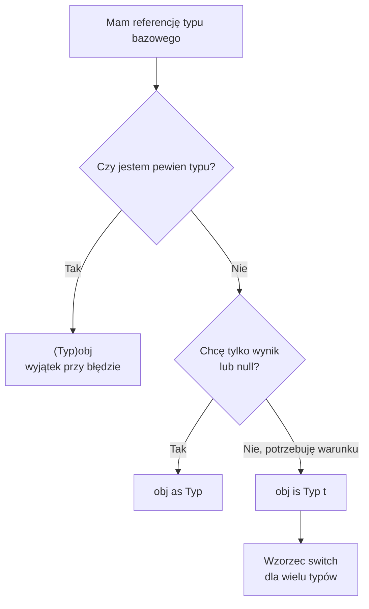
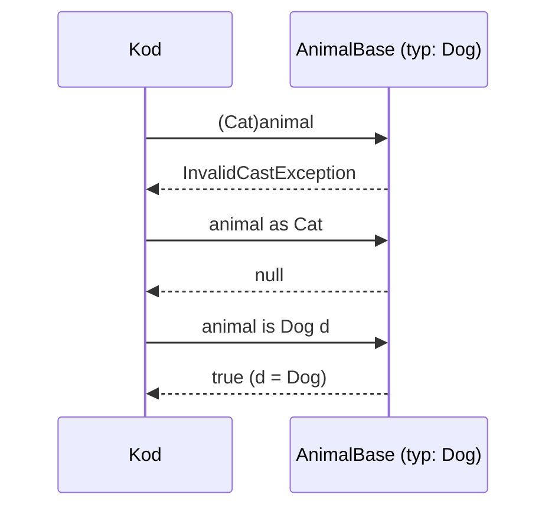

# TEMAT 6: Operatory rzutowania (Casting Operators)

## 📖 Wprowadzenie

W hierarchii dziedziczenia obiekt ma **typ statyczny** (ten, który widzi kompilator w zmiennej) i **typ rzeczywisty** (ten, którym faktycznie jest w pamięci). Rzutowanie pozwala przejść z typu bazowego do pochodnego, gdy wiemy lub sprawdzamy, że obiekt jest tym typem.

C# udostępnia trzy główne mechanizmy:

| Mechanizm | Zachowanie przy błędzie | Wynik |
|-----------|--------------------------|-------|
| `(Typ)obj` | Rzuca `InvalidCastException` | Referencja typu `Typ` |
| `obj as Typ` | Zwraca `null` | Referencja lub `null` |
| `obj is Typ t` | Zwraca `false` | `bool`, a przy `true` zmienna `t` |

```
AnimalBase animal = new Dog();

  (Dog)animal     → ✅ Dog
  (Cat)animal     → 💥 InvalidCastException (to Dog, nie Cat)
  animal as Cat   → null (bez wyjątku)
  animal is Dog d → true, d jest Dog
```

---

## 🎯 Kluczowe Koncepty

### 1. Rzutowanie jawne `(Typ)`

Gdy jesteś pewien typu, użyj rzutowania. Jeśli się mylisz, program zakończy się wyjątkiem:

```csharp
AnimalBase animal = new Dog();
Dog dog = (Dog)animal;   // ✅ działa
dog.Fetch();
```

### 2. Operator `as`

Gdy typ nie jest pewny, `as` zwraca `null` zamiast wyjątku. Działa tylko dla typów referencyjnych (i typów dopuszczających `null`):

```csharp
AnimalBase animal = new Cat();
Dog? dog = animal as Dog;     // null — nie ma wyjątku
if (dog is not null)
    dog.Fetch();
```

### 3. Operator `is` i dopasowanie wzorca

`is` sprawdza typ i od razu przypisuje zmienną, jeśli test się udał:

```csharp
if (animal is Dog d)
    d.Fetch();                // d jest typu Dog tylko wewnątrz if
```

Negacja z C# 9 (`is not`) czyta się naturalnie:

```csharp
if (animal is not Dog)
    Console.WriteLine("To nie jest pies");
```

### 4. Wzorce `switch`

Wiele typów można obsłużyć w jednym miejscu:

```csharp
switch (animal)
{
    case Dog d: d.Fetch();    break;
    case Cat c: c.Scratch();  break;
    default:                  break;
}
```

---

## 💻 Praktyczne Przykłady

### Przykład 1: Hierarchia zwierząt

```csharp
public abstract class AnimalBase
{
    public string Name { get; set; } = "";
}

public class Dog : AnimalBase
{
    public void Fetch() => Console.WriteLine($"{Name} przynosi piłkę");
}

public class Cat : AnimalBase
{
    public void Scratch() => Console.WriteLine($"{Name} drapie słupek");
}
```

### Przykład 2: Bezpieczne rzutowanie z `as`

```csharp
AnimalBase[] zoo = { new Dog { Name = "Burek" }, new Cat { Name = "Filemon" } };

foreach (var animal in zoo)
{
    var dog = animal as Dog;
    dog?.Fetch();          // wywołane tylko dla psa
}
```

### Przykład 3: Dopasowanie wzorca w pętli

```csharp
foreach (var animal in zoo)
{
    switch (animal)
    {
        case Dog d:
            d.Fetch();
            break;
        case Cat c:
            c.Scratch();
            break;
    }
}
```

Ten kod nie wymaga żadnego `as` ani ręcznego sprawdzania `null`.

### Przykład 4: Wyjątek przy złym rzutowaniu

```csharp
AnimalBase animal = new Dog();

// Cat cat = (Cat)animal;   // 💥 InvalidCastException — to Dog, nie Cat
```

Linia jest zakomentowana w kodzie projektu, bo celowo kończy się wyjątkiem. Zawsze sprawdzaj typ przed rzutowaniem jawnym, jeśli nie masz pewności.

### Przykład 5: Operator `is` z negacją w regule biznesowej

```csharp
public interface IPayment { void Process(); }

public class CreditCardPayment : IPayment
{
    public string CardNumber { get; init; } = "";
    public void Process() => Console.WriteLine($"Karta: {CardNumber}");
    public void ApplyDiscount(decimal percent) { /* ... */ }
}

public class PaymentProcessor
{
    public void ProcessPayment(IPayment payment)
    {
        if (payment is CreditCardPayment cc)
            cc.ApplyDiscount(0.05m);   // 5% zniżki tylko dla kart

        payment.Process();
    }
}
```

Ten sam wzorzec działa dla interfejsów: `IPayment` nie zna `ApplyDiscount`, więc rzutowanie na konkretny typ jest konieczne.

---

## 📊 Diagram: Wybór operatora





---

## ⚡ Ograniczenia i Reguły

1. **Rzutowanie jawne nie sprawdza typu bez wyjątku** — błędny typ kończy się `InvalidCastException`.
2. **`as` nie działa dla typów wartościowych** bez `Nullable<T>` (np. `int as int` jest błędem).
3. **Rzutowanie nie zmienia obiektu** — tylko zmienia sposób, w jaki się na niego patrzy.
4. **Kompilator odrzuca rzutowanie między typami, które nie mają wspólnej relacji** (np. dwie niezwiązane klasy, błąd CS0030), ale nie zna typu wykonania obiektu, więc przy typie bazowym błąd pojawia się dopiero w czasie działania.

---

## 🔑 Kluczowe Punkty

- `(Typ)obj` — gdy jesteś pewien, wyjątek przy pomyłce
- `obj as Typ` — gdy możesz obsłużyć `null`
- `obj is Typ t` — gdy chcesz warunku i zmiennej w jednym kroku
- Wzorce `switch` i `is not` czynią kod czytelniejszym niż łańcuchy `if`/`as`

---

## ▶️ Uruchomienie

```bash
cd code
dotnet test
```

Projekt zawiera **8 testów xUnit** (`[Fact]`).

---

## 📚 Referencje

- [Casting and type conversions (Microsoft Learn)](https://learn.microsoft.com/en-us/dotnet/csharp/programming-guide/types/casting-and-type-conversions)
- [Pattern matching (C#)](https://learn.microsoft.com/en-us/dotnet/csharp/fundamentals/functional/pattern-matching)

---

## ✅ Efekty Uczenia

Po tym temacie student potrafi:

- [ ] Wybrać między `(Typ)`, `as` i `is` w zależności od sytuacji
- [ ] Przewidzieć wynik rzutowania, które kończy się wyjątkiem lub `null`
- [ ] Zastosować dopasowanie wzorca w `if` i `switch`
- [ ] Użyć `is not` do negacji sprawdzenia typu
