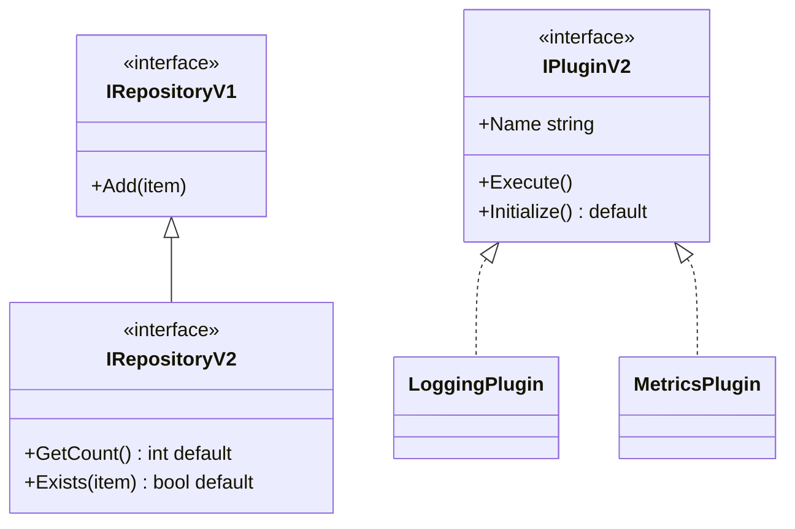
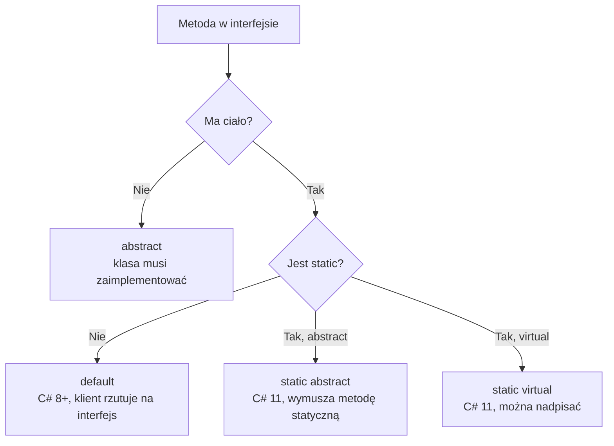

# TEMAT 7: Zaawansowane interfejsy (C# 8–11)

## 📖 Wprowadzenie

Nowsze wersje C# rozszerzyły interfejsy o możliwości, których wcześniej nie miały:

| Wersja C# | Funkcja | Przykład |
|-----------|---------|----------|
| 8.0 | **Domyślne implementacje** członków interfejsu | `void LogInfo(string m) => Log(m);` |
| 8.0 | Członki `private` i `protected` w interfejsie | `private void Helper() { }` |
| 11 | **`static abstract`** i **`static virtual`** | `static abstract T Convert(T v);` |

Dzięki temu można **dodać nową metodę do istniejącego interfejsu** bez psucia implementacji, które już istnieją. To ważne w bibliotekach publicznych, gdzie zmiana kontraktu wymaga ostrożności.

```
ILoggerV1 (v1)            ILoggerV1 (v2 — dodano LogInfo z domyślną implementacją)
┌───────────────┐         ┌──────────────────────────────┐
│ Log(msg)      │         │ Log(msg)                     │
└───────────────┘         │ LogInfo(msg) => Log(...)     │ ← domyślna
                          └──────────────────────────────┘
Stary kod z implementacją Log() nadal się kompiluje.
```

---

## 🎯 Kluczowe Koncepty

### 1. Domyślna implementacja członka interfejsu

```csharp
public interface ILoggerV1
{
    void Log(string message);

    void LogInfo(string message) => Log($"[INFO] {message}");
    void LogWarning(string message) => Log($"[WARN] {message}");
}

public class ConsoleLoggerV1 : ILoggerV1
{
    public void Log(string message) => Console.WriteLine(message);
    // LogInfo i LogWarning są dziedziczone z interfejsu
}
```

### 2. Wywołanie domyślnej implementacji wymaga typu interfejsu

Klasa nie dziedziczy członków domyślnych jako własnych — trzeba rzutować:

```csharp
var logger = new ConsoleLoggerV1();
// logger.LogInfo("x");                // ❌ CS1061
((ILoggerV1)logger).LogInfo("x");      // ✅ [INFO] x
```

### 3. Dziedziczenie między interfejsami

```csharp
public interface IRepositoryV1
{
    void Add(string item);
}

public interface IRepositoryV2 : IRepositoryV1
{
    int GetCount() => 0;               // domyślna implementacja
    bool Exists(string item) => false;
}
```

### 4. `static abstract` — kontrakt dla metod statycznych (C# 11)

Interfejs może wymusić istnienie metody statycznej. Konkretna klasa ją dostarcza, a kod generyczny wywołuje ją przez parametr typu:

```csharp
public interface IConverterV3<TSelf> where TSelf : IConverterV3<TSelf>
{
    static abstract double Convert(double value);
    static virtual double ConvertBack(double value) => value;
}

public class FahrenheitToCelsius : IConverterV3<FahrenheitToCelsius>
{
    public static double Convert(double f) => (f - 32) * 5 / 9;
}
```

Generyczna metoda używa `T.Convert`:

```csharp
public static class Converter
{
    public static double ConvertValue<T>(double value) where T : IConverterV3<T>
        => T.Convert(value);
}

double celsius = Converter.ConvertValue<FahrenheitToCelsius>(212);   // 100
```

Bez `static abstract` trzeba by przekazywać obiekt konwertera albo używać refleksji.

### 5. Członki `private` i `protected` w interfejsie (C# 8+)

```csharp
public interface IDataProcessor
{
    void Process(string data)
    {
        ValidateData(data);
        LogMessage($"Przetwarzam: {data}");
    }

    protected void ValidateData(string data)
    {
        if (string.IsNullOrEmpty(data)) throw new ArgumentException("Brak danych");
    }

    private void LogMessage(string msg) => Console.WriteLine(msg);
}
```

Członki pomocnicze są ukryte przed klientami interfejsu, a domyślna metoda `Process` z nich korzysta.

---

## 💻 Praktyczne Przykłady

### Przykład 1: Bezpieczna ewolucja interfejsu wtyczek

Wtyczki v1 implementują `Execute`. Wersja 2 dodaje `Initialize` z domyślną implementacją:

```csharp
public interface IPluginV2
{
    string Name { get; }

    public void Initialize()
        => Console.WriteLine($"Initializing {Name}...");   // domyślna implementacja

    void Execute();                                       // wymagane

    static virtual int Priority => 0;                     // domyślny priorytet (static virtual)
}

public class LoggingPlugin : IPluginV2
{
    public string Name => "LoggingPlugin";
    public static int Priority => 10;                     // nadpisuje wartość statyczną

    public void Execute() => Console.WriteLine("Logging plugin executed");
    // Initialize() dziedziczone z interfejsu
}

public class MetricsPlugin : IPluginV2
{
    public string Name => "MetricsPlugin";
    public void Execute() => Console.WriteLine("Metrics plugin executed");
    // Priority = 0 z domyślnej implementacji interfejsu
}
```

Klasa `MetricsPlugin` nie definiuje `Initialize`, więc każde wywołanie trafia do domyślnej implementacji z interfejsu. Gdyby klasa miała własną publiczną metodę `Initialize()` o tej samej sygnaturze, zaimplementowałaby członka interfejsu i wywołanie przez `IPluginV2` użyłoby jej wersji. Domyślna implementacja działa tylko wtedy, gdy klasa jej nie przesłania.

### Przykład 2: Usługa z ukrytą logiką

```csharp
public interface IAdvancedService
{
    void Start()
    {
        ValidateConfiguration();
        LogInternal("Usługa uruchomiona");
    }

    protected void ValidateConfiguration() { /* ... */ }
    private void LogInternal(string msg) => Console.WriteLine(msg);
}

public class WebService : IAdvancedService
{
    // Start() dziedziczone z interfejsu — klient widzi tylko publiczny kontrakt
}
```

Klient wywołuje `Start()`, ale nie ma dostępu do `LogInternal`. Ukrywanie szczegółów to zaleta domyślnych implementacji.

### Przykład 3: Przekazanie wyboru konwertera przez parametr typu

```csharp
double miles = Converter.ConvertValue<MilesToKilometers>(10);   // ~16.09
double fahr  = Converter.ConvertValue<FahrenheitToCelsius>(98.6);
```

Ten sam kod generyczny obsługuje różne konwersje, a kompilator sprawdza, czy typ implementuje `IConverterV3<T>`.

---

## 📊 Diagram: Ewolucja interfejsu





---

## ⚡ Ograniczenia i Reguły

1. **Domyślne implementacje wymagają C# 8.0+** (projekt używa nowszej wersji).
2. **`static abstract` i `static virtual` wymagają C# 11+**.
3. **Członka domyślnego nie wywołuje się przez zmienną typu klasy** — trzeba rzutować na interfejs (CS1061).
4. **Projekt z własnym `Main` i Test SDK** wymaga `<GenerateProgramFile>false</GenerateProgramFile>`, inaczej powstaną dwa punkty wejścia (CS0017). Ustawienie jest w pliku `.csproj` tego tematu.

---

## 🔑 Kluczowe Punkty

- Domyślne implementacje pozwalają ewoluować interfejsy bez psucia istniejącego kodu
- Członki `private` i `protected` ukrywają szczegóły w interfejsie
- `static abstract` pozwala wymusić metody statyczne i używać ich w kodzie generycznym
- Wybór między klasą abstrakcyjną a interfejsem zależy od tego, czy potrzebujesz stanu (pól) — interfejs go nie ma

---

## ▶️ Uruchomienie

```bash
cd code
dotnet run    # demonstracje (Program.cs)
dotnet test   # testy xUnit
```

Projekt zawiera **7 testów xUnit** (`[Fact]`) oraz **demonstracje** w `Program.cs`.

---

## 📚 Referencje

- [Default interface methods (Microsoft Learn)](https://learn.microsoft.com/en-us/dotnet/csharp/language-reference/proposals/csharp-8.0/default-interface-methods)
- [Static abstract members in interfaces (C# 11)](https://learn.microsoft.com/en-us/dotnet/csharp/whats-new/csharp-11#static-virtual-members-in-interfaces)

---

## ✅ Efekty Uczenia

Po tym temacie student potrafi:

- [ ] Dodać do interfejsu metodę z domyślną implementacją
- [ ] Wywołać domyślną implementację przez rzutowanie na interfejs
- [ ] Zastosować `static abstract` w kodzie generycznym
- [ ] Ukryć szczegóły interfejsu przez członki `private` i `protected`
